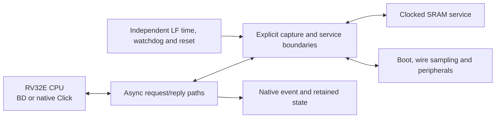

# RISCay-MCU integration corpus

[RISCay-MCU](https://github.com/BiscutLabs/RISCay-MCU) is built in its own repository using chisel-async. The first complete Chiselator application is now an existing hybrid MCU to integrate, not an MCU to design here. See the [baseline and source pins](integration-status.md). Native Chiselator acceptance remains pending.

## Implemented design and ownership

The shared CPU implements **RV32E**, with sixteen 32-bit registers and one instruction in flight. Compressed instructions and M/D extensions are absent. The four-phase bundled-data implementation is the primary physical development variant; the native two-phase Click implementation is a functional reference variant.

The reference configuration has 2 KiB executable SRAM and 1 KiB working SRAM. Boot includes external SPI NOR A/B slots, golden recovery and an I²C loader fallback. Memory capacities and peripheral profiles remain MCU-owned configuration. The earlier RV32EC, fixed 2 KiB ROM and 256-byte RAM estimates are superseded.

CPU and major SoC paths use handshakes. Low-frequency timekeeping, watchdog/reset qualification, some service coordination, wire sampling and production SRAM interfaces use clocks. Model actual clock/reset domains; do not advertise the entire SoC as clockless or force its timekeeping onto a synthetic CPU cycle.

The MCU is a generic firmware platform. Raspberry Pi supervision is a possible application profile, not fixed hardware behavior or the universal simulator acceptance workload. Its owning repository defines boot, sleep, memory and peripheral semantics. External application firmware remains separately versioned.

## Integration manifest

Pin MCU/library/compiler revisions, variant, profile parameters, exported RTL/contracts/probes, resource hashes, firmware ELF/binary and reset/clock configuration. Record the reference simulator and independent ISA/effect checker revisions. Reuse upstream build commands from [build and test](https://github.com/BiscutLabs/RISCay-MCU/blob/870124a93c5e9ed86f2ca52a45c4f24bdb8851d6/docs/build-and-test.md); avoid a second set of mutable build instructions here.

Use the [SoC contract](https://github.com/BiscutLabs/RISCay-MCU/blob/870124a93c5e9ed86f2ca52a45c4f24bdb8851d6/docs/soc-contract.md), [memory architecture](https://github.com/BiscutLabs/RISCay-MCU/blob/870124a93c5e9ed86f2ca52a45c4f24bdb8851d6/docs/memory-architecture.md), and [sleep/clock contract](https://github.com/BiscutLabs/RISCay-MCU/blob/870124a93c5e9ed86f2ca52a45c4f24bdb8851d6/docs/sleep-and-clock.md). Static export audits and retired test probes must not be counted as fresh dynamic coverage.

## Native acceptance

MCU-01 checks RV32E retirement, boot/images, memory and exactly-once effects. MCU-02 checks normal boot, loader, peripherals and wait/wake. MCU-03 checks faults, watchdog deadlines, invalid images and recovery. MCU-04 checks handshakes, clocks, reset epochs and retained/persistent work in both variants. The [test plan](test-plan.md) owns the detailed acceptance suites.

An application reset may cancel a response while already accepted POR-owned persistent work finishes. Track channel termination separately from the effect owner's reset domain; an aborted response is not proof that a write never occurred. Receipt-based boundaries also must not be modeled as hidden payload FIFOs. Both cases belong in the [transaction schema](graph-event-contract.md).

Application-specific power policy tests are added when that firmware/profile is selected. MCU-05 remains a separate real-board application gate, including Pi integration if claimed. MCU-06 and the [physical evidence suites](chip-build-plan.md#tests-and-evidence) cover physical claims. None is a prerequisite for functional native simulation.
