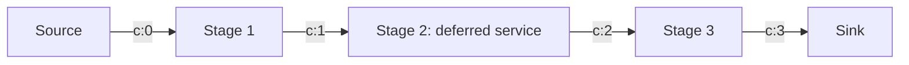
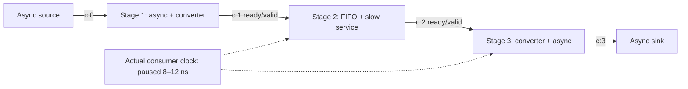

# Pipeline bottleneck contract fixtures

Draft, October 25, 2026. These are hand-authored normalized records and independently specified rational expectations. No simulator, plugin host, analyzer or upstream probe produced them. Zero model/package hashes are placeholders; artifact hashes are real. Synthetic `fixture.*` contracts and `service-deferred` are local test vocabulary, not chisel-async probe names. Runtime and raw-decoder qualification remain open.

Both forms use the half-open window `[0,24 ns)`, initially idle channel transactions, no reset, exact phase metadata and complete declared coverage. The middle stage's service is deliberately deferred until 18 ns. This short transient is evidence for a candidate in this window, not a proof that the stage limits steady-state throughput. Defaults in the expected configuration are input backpressure ≥ 1/2, output starvation ≥ 1/2 and at least one actual edge for each clocked fraction. Async fractions require known state over a positive duration, not a minimum transaction count. The configuration hash uses UTF-8 JSON with sorted keys, compact separators and no trailing newline.

## Form A: four-phase async

[Graph](async/design-graph.json), [flow stream](async/flow-events.jsonl), [probe stream](async/probe-events.jsonl), [capture](async/capture-manifest.json) and [expected result](async/expected-result.json) form one bundle. All four channels follow the held-return four-phase protocol. There is no clock or sampled-edge denominator. Queue coverage is not requested; occupancy is unavailable, not zero.

| Channel | Offer / accept / complete, ns | Offered but unaccepted | No outstanding transaction |
| --- | --- | --- | --- |
| c:0 | 0 / 1 / 2 | 1/24 | 22/24 |
| c:1 | 2 / 18 / 19 | 16/24 | 7/24 |
| c:2 | 18 / 19 / 20 | 1/24 | 22/24 |
| c:3 | 20 / 21 / 22 | 1/24 | 22/24 |

An async transaction is outstanding from offer through completion or abort, including return-to-idle recovery. For c:1 that is `[2,19)`, so starvation is `(24 - 17)/24 = 7/24`, not `(24 - 16)/24`. Each channel has one transaction; no lifecycle is censored. The expected JSON stores durations in femtoseconds, preserving integer rational arithmetic.

Stage 2 meets both thresholds: input backpressure `16/24 = 2/3`, output starvation `22/24 = 11/12`. Stage 1 has input backpressure `1/24` and is not a candidate; its **output backpressure 16/24** is an upstream symptom. Stage 3 has input backpressure `1/24` and is not a candidate; its **input starvation 22/24** is a downstream symptom. The service wait is `[2,18)`, duration 16 ns. Stage 3 has a separately recorded `[0,18)` wait with cause `unknown`; its duration is known but does not establish why it waited.

The moved-stage negative control changes c:0 to `0 / 16 / 17` and c:1 to `17 / 18 / 19`, retaining later channel times. Stage 1 then meets `16/24` input backpressure and `22/24` output starvation. Stage 2 now has only `1/24` input backpressure. The old expected middle-stage finding must fail comparison even though record shapes, lifecycles and coverage remain valid. The independent test formula computes this control; no production analysis code generates expectations.

## Form B: hybrid with bounded storage

[Graph](hybrid/design-graph.json), [flow stream](hybrid/flow-events.jsonl), [probe stream](hybrid/probe-events.jsonl), [capture](hybrid/capture-manifest.json) and [expected result](hybrid/expected-result.json) form the second bundle. Stage 1 contains an async producer plus an explicit output converter; stage 3 contains the input converter plus an async consumer. Their boundary contracts each declare one RTL storage slot. c:0 and c:3 are four-phase; c:1 and c:2 are sampled ready/valid on the actual consumer clock. These adapters belong to the synthetic circuit, not to the simulator.

Clock edges are at `2,4,6,12,14,16,18,20,22 ns`, indices 1–9. The clock starts running with managed generation 0, pauses at 8 ns with generation 1 and resumes at 12 ns with generation 1. There are no samples at 8 or 10 ns. RLE intervals split at the pause/resume state change even if the class remains unchanged. The clock-state reference orders the resume before the 12 ns edge without relying on timestamp proximity.

| Channel | Transferred | Backpressured | Starved | Idle | Total actual edges |
| --- | --- | --- | --- | --- | --- |
| c:1 | 2 (2,18 ns) | 5 (4,6,12,14,16 ns) | 1 (20 ns) | 1 (22 ns) | 9 |
| c:2 | 1 (20 ns) | 0 | 7 (2,4,6,12,14,16,18 ns) | 1 (22 ns) | 9 |

Stage 2 is a candidate with `5/9` input backpressure and `7/9` output starvation. Stage 1's output backpressure is `5/9`; stage 3's input starvation is `7/9`. Their own input backpressure is respectively `2/24` and `0/9`, so neither is a candidate. c:0 has transactions `0 / 1 / 2` and `2 / 3 / 4`, giving starvation `20/24`. Stage 1 has captured its second input before the 4 ns backpressured sample and retains it until the 18 ns transfer. c:3 has `20 / 21 / 22`, giving starvation `22/24`. Every sampled channel has nine edge observations, and neither sampled transfer has an invented pre-fire offer time. All lifecycle/edge censoring counts are zero.

The queue `q:middle` has capacity 2 from c:1. It starts with resident token A, enqueues B at 2 ns, dequeues A then enqueues C at 18 ns, dequeues B at 20 ns and dequeues C at 22 ns. Queue tokens have their own IDs; the fixture makes no implicit transaction correlation. The later dequeues need not imply an output transfer in this window. Initial queued work and channel-idle initial state are independent facts.

| Interval, ns | Occupancy | Area, token·ns |
| --- | --- | --- |
| [0,2) | 1 | 2 |
| [2,18) | 2 | 32 |
| [18,20) | 2 | 4 |
| [20,22) | 1 | 2 |
| [22,24) | 0 | 0 |

Area is `40 token·ns`; mean occupancy is `40/24 = 5/3 tokens`. Full duration is 18 ns and empty duration is 2 ns. The same-time dequeue/enqueue retains both identities but adds no intermediate elapsed area. There are five queue operations after the snapshot. The service wait lasts 16 ns; stage 3's unknown-cause wait lasts 20 ns. Neither wait is a causal edge or input to the bottleneck predicate.

## What these examples qualify

The [validator and tests](../../schemas/README.md) check normalized shapes, references, exact coverage, sample classes, queue bounds/identities, vocabulary membership and independently calculated fixture arithmetic. Negative controls isolate moved service, gated sampling, empty dequeue, undeclared reasons and missing probe coverage; additional controls exercise overlapping intervals and numeric unknowns. They do not qualify raw probes, RTL behavior, scheduling transparency, complete causal explanations or a production analyzer. Component probes and ABI must come from upstream chisel-async before those gates can pass.
