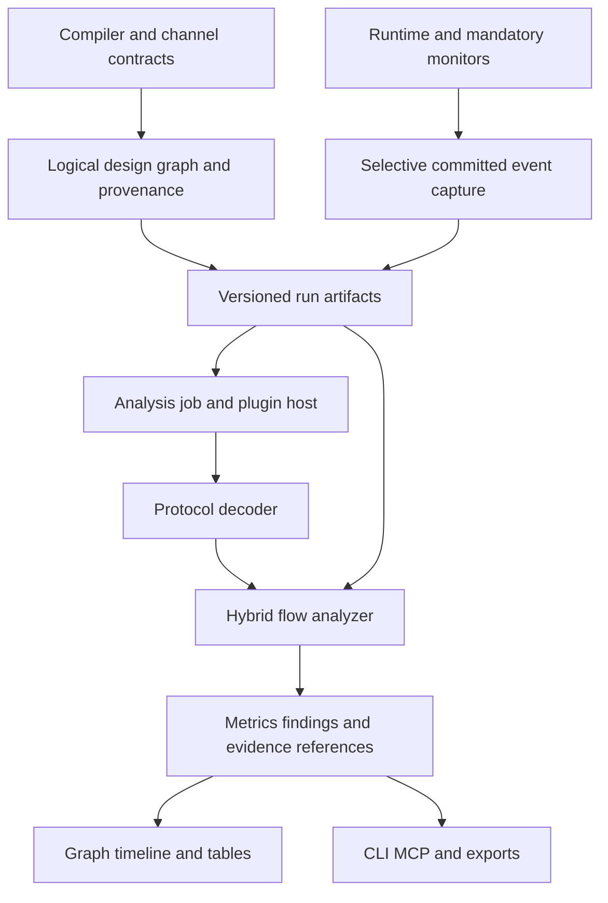

# Extensibility and hybrid flow analysis plan

Chiselator will expose a versioned extension interface for analysis and tool integration. Its first analysis plugin will explain traffic, waiting and bottleneck candidates in fully clocked, fully asynchronous and hybrid designs containing both. The main user workflow is a connected component graph, transaction timeline and metrics table, with findings linked to recorded evidence and source locations.

This is a planning contract; no plugin host, analyzer or viewer is implemented. It extends the [software architecture](software-architecture.md) and [MVP feature list](mvp-feature-list.md). The [five specifications](specs/README.md) continue to own execution semantics, compiler/runtime interfaces, primitive contracts, application lifecycle and artifact compatibility. Analysis consumes those contracts without changing them.

The product order remains chisel-async, RISCay-MCU, Chiselator, then physical implementation. This work belongs to Chiselator in step 3. It requires no PDK, synthesis tool or working physical chip. Vivado integration remains a step 4 tool adapter; physical-tool results can later become additional graph overlays.

## Product outcomes and first release

The first plugin release must let a user select a completed run, explore its logical graph, choose a simulated-time interval, locate delayed or heavily used channels, and inspect the transactions supporting a finding. It must also run without a viewer through the CLI and MCP report APIs.

Start with recorded-run analysis and a local interactive report. The event contract leaves room for live delivery, but live updates are a later feature. The initial native decoder set covers the existing four-phase bundled-data contract and an explicitly specified clocked ready/valid contract. Test pure clocked and pure async designs as well as their composition. Two-phase, QDI and richer bus decoders are later capabilities with independent qualification; library support alone does not imply native simulator or analyzer support.

Ordinary clocked designs remain valid without channel annotations. Their signal and clock views remain available, while transaction analysis requires declared interfaces and supported decoders. Missing channel metadata must produce a visibility limitation, not inferred transactions from similarly named signals.

## Existing tooling and design implications

The following documented features inform the design. They are precedents, not dependencies or evidence that an upstream product implements our hybrid semantics.

| Tool | Relevant capability | Application here |
| --- | --- | --- |
| [AMD Vitis Dataflow Viewer](https://docs.amd.com/r/2025.2-English/ug1702-vitis-accelerated-reference/Dataflow-Viewer) | Process/channel graphs, source navigation, filtering and measured channel/process behavior from RTL co-simulation | Link topology to measured traffic and waits. This is an HLS-specific workflow, not automatic profiling for arbitrary Vivado RTL. |
| [Synopsys Verdi](https://www.synopsys.com/verification/debug/verdi.html) | Transaction/protocol views, latency/bandwidth analysis, waveform comparison and tracing | Follow transactions and compare behavior across runs. |
| [Cadence Verisium Debug](https://www.cadence.com/en_US/home/tools/system-design-and-verification/ai-driven-verification/verisium-debug.html.html) | Connected waveform/source/hierarchy/schematic views and Python functions, widgets and integrations | Expose structured analysis and presentation extension points. |
| [Vivado CDC report](https://docs.amd.com/r/en-US/ug906-vivado-design-analysis/Report-Clock-Domain-Crossings) | Structural analysis of clock-domain crossings, distinct from timing-slack analysis | Keep crossing structure, runtime behavior and physical timing findings separate. |
| [ACT channel loggers](https://avlsi.csl.yale.edu/act/doku.php?id=sim:loggers) and [Workcraft verification](https://workcraft.org/help/verification) | Successful token logging and checks such as transition consistency, deadlock freeness and mutex protocol properties | Preserve async protocol meaning and distinguish observed failures from formal properties. |
| [Verilator execution profiling](https://verilator.org/guide/latest/simulating.html#execution-profiling) | Execution timelines and host-thread work distribution | Keep simulated hardware performance separate from simulator execution cost. |
| [Perfetto plugins](https://perfetto.dev/docs/contributing/ui-plugins) and [trace processing](https://perfetto.dev/docs/analysis/trace-processor) | Trace-scoped tracks, tabs and commands; queryable recorded traces | Separate capture, analysis and presentation, and support offline queries. |
| [QEMU plugins](https://www.qemu.org/docs/master/devel/tcg-plugins.html) | Version negotiation, opaque internals and efficient instrumentation | Publish explicit compatibility and batch observations without exposing compiler objects. |

## Extension boundaries

| Extension family | Access and ownership | Release scope |
| --- | --- | --- |
| Protocol decoders | Read committed observations and declared protocol contracts; produce normalized transaction records | Initial supported decoders plus an SDK interface |
| Analyzers | Read graph, transactions and run metadata; produce metrics and evidence-linked findings | First public extension interface |
| Presentation extensions | Supply declarative overlays, tracks, tables and detail records keyed by semantic IDs | Local graph report first; arbitrary embedded UI code deferred |
| Importers and exporters | Convert validated artifacts and preserve source precision, coverage and provenance | Small export plugin proves independent reuse; other adapters follow |
| External tool adapters | Use supervised jobs with typed inputs, artifact outputs, cancellation and capability checks | Reuse application lifecycle; physical tools remain step 4 |
| Compiler, primitive and execution extensions | Participate in circuit semantics through their existing qualified interfaces | Separate versioning and tests; no arbitrary runtime model loading in the MVP |

The runtime owns time, event ordering, model state, random choices and mandatory protocol monitors. Analysis plugins cannot drive signals, advance the scheduler or replace mandatory checker verdicts. A decoder interpreting raw observations must agree with the registered protocol version; it cannot invent new acceptance or reset semantics. Official monitor observations, where available, remain authoritative evidence of the simulated contract.

## Plugin packaging and lifecycle

Use supervised local executables with a small versioned control protocol over standard input/output and immutable artifact references for bulk data. Use argument arrays and native process supervision on Windows, Linux and macOS. Diagnostic logs use standard error. JSON/JSONL is the initial portable encoding; binary batches require a measured need and a new advertised capability.

A manifest declares plugin ID/version, executable identity, compatible host protocol and artifact schemas, capabilities, supported channel contract versions, required observations, produced result schemas and runtime dependencies. Project configuration explicitly selects installed plugins and records their resolved versions, hashes and configuration. Do not auto-install or execute plugins named only by an imported trace. A process boundary isolates many crashes but is not a security sandbox; plugin executables are trusted local code.

The proposed lifecycle is:

1. Resolve and validate the selected plugin manifest and executable.
2. Exchange capabilities and reject incompatible versions or missing required observations before analysis.
3. Submit an analysis request naming input artifact hashes, the requested window/filters and limits.
4. Receive bounded progress and diagnostics; support cancellation and enforce process, memory and output budgets.
5. Validate result schemas, graph references and artifact hashes, then publish outputs atomically.

An analysis request has a unique ID and one terminal response. EOF, malformed messages, duplicate terminal responses, timeout and cancellation retain distinct diagnostics. Protocol compatibility is separate from plugin semantic versioning. Unknown optional fields may be ignored under a compatible schema; unknown required features fail explicitly.

Analysis jobs record COMPLETE, PARTIAL, ERROR, TIMEOUT or CANCELED, separately from the simulation outcome. Finding a bottleneck is not an analysis error. An analysis crash cannot rewrite the simulation result. A regression that requires the analysis must fail its qualification gate if the analysis is unavailable or incomplete. Explicit CI thresholds can turn a supported measured regression into a test failure; heuristics alone cannot silently fail a circuit.

Ship the first-party analyzer as a native executable alongside Chiselator so its default path adds no Python or Node runtime requirement. Third-party plugins may use other languages with declared dependencies. Publish schemas, small fixtures, a minimal example plugin and compatibility tests. Do not expose Rust object layouts, MLIR handles or generated-code addresses.

## Shared graph and observation contract

The public graph describes logical components, ports and channels. Compiler partitions, replicated kernels and storage layouts are separate internal structures. A source component can map to several execution regions; a region may implement several components. Record this mapping explicitly for optional simulator-cost analysis rather than treating a kernel as a hardware block.

| Record | Minimum information |
| --- | --- |
| Component | Model-scoped semantic ID, hierarchy, source reference, kind, ports, clock/reset domains and available observations |
| Channel | ID, producer/consumer endpoints, protocol/version, payload description, capacity where defined, reset policy and ordering rules |
| Boundary | Converter/FIFO/synchronizer identity, source/destination domains and contracts, buffering and qualified transaction mapping |
| Observation | Run/execution identity, event ID and ordered sequence, exact time/delta/phase, semantic object ID, reset epoch and typed event data |
| Transaction | Channel/epoch/local identity, offer/accept/complete/abort observations, pending status and available parent relationships |
| Measurement | Metric/version, object/window, numerator/denominator and units, sample count, observation coverage and evidence references |
| Finding | Rule/version, affected IDs, severity, measured evidence, classification and explicit assumptions or unavailable inputs |

The compiler exports channel identities and validates their mapping through lowering. chisel-async owns reusable protocol metadata; supported SV designs can supply equivalent declarations. A missing required endpoint is an error. Semantic IDs are stable across supported optimization/backend layouts within the model identity; arbitrary source revisions require an explicit comparison mapping.

Capture committed transitions before they can be coalesced away. A settled-state poll cannot reconstruct every handshake edge or pulse. Delivery to plugins may be delayed or batched without changing event order. Capture configuration is part of run/build identity where applicable, and required observations constrain compiler optimization eligibility.

Use the existing exact integer time contract and decimal-string serialization. Retain delta/phase/sequence ordering for same-time transitions. Browser rendering may scale coordinates, but exact values, filtering and calculations cannot pass through lossy JavaScript floating-point timestamps. Host duration and simulated duration are different fields and metric families.

Each recording declares included objects/events, time coverage, starting state or a valid checkpoint of decoder state, reset epochs, dropped ranges and its actual ending frontier. An analysis subwindow reconstructs state from an earlier complete prefix or a validated snapshot. Transactions already in progress at the window start or still pending at its end remain explicitly censored observations; they cannot silently disappear from reported populations.

Detailed capture is opt-in and selective. Required records use bounded buffering with backpressure or an explicit failure; optional history may truncate only with coverage metadata. A live viewer later receives copies of the same stream and cannot influence simulated ordering. Performance tests measure disabled capture, enabled capture and offline analysis separately.

## Protocol and hybrid semantics

For the initial four-phase contract, request assertion offers a transaction, acknowledgement assertion accepts it, and return to idle completes the handshake. Preserve all four transitions and reset-abort events. Repeated payload values still identify different transactions. Acceptance does not automatically mean a memory write or instruction retirement; the component declares its effect point.

For the initial declared clocked ready/valid contract, a transaction is first observed as offered at an eligible sampling edge with valid asserted; acceptance occurs at an eligible edge with both valid and ready asserted. The producer holds valid and payload until acceptance except under the declared reset rule. Consecutive accepting edges create distinct transactions even if valid stays high and payload is unchanged. Record edge polarity and reset priority. Sampled offer-to-accept latency does not include unobserved producer waiting before that first edge; cross-protocol comparisons must state their event definitions. Do not reinterpret request/acknowledge wires as ready/valid. Two-phase decoding later uses toggles and an explicit initial phase; QDI decoding needs its encoding and spacer/completion contract.

Hybrid graphs can contain independent clocks, negedges, paused clocks, clock enables and async regions. Report physical simulated time across domains, with local sampling-edge counts as optional context. Preserve time spent waiting while a clock is paused; do not silently remove it from utilization or latency denominators. Legitimate clock suspension or absence of external input is not automatically a stall defect.

Converters and storage expose input/output transaction relationships. Forks can create multiple children; joins can consume multiple parents. Do not infer causality by equal payloads or nearby timestamps. Unsupported or ambiguous relationships stay unknown. Initial native analysis qualifies four-phase/ready-valid boundaries, with explicit FIFO/reset rules, before expanding protocol families.

## Metrics and interpretation

All rates name their observation window, counted event and denominator. Use half-open windows `[start, end)` consistently. A zero-duration window has no time-based rate. Counts and simulated-time intervals are exact; derived ratios state rounding, and latency quantiles state their algorithm and sample count.

The initial latency cohort is transactions offered within the selected window, with completed samples and censored/aborted counts reported separately. An independently offered transaction crossing into the window remains visible but does not silently join that cohort. Acceptance/completion event rates count their respective events inside the window. Coverage gaps make full-window metrics unavailable; explicitly selected complete subwindows may be analyzed separately, never silently spliced into a healthy-looking rate.

| Metric | Definition and qualification |
| --- | --- |
| Traffic | Offered, accepted and completed transaction counts, separately; accepted transactions divided by observed simulated duration for the acceptance rate |
| Acceptance latency | Acceptance time minus offer time, only when both endpoints are known; report pending/censored populations alongside the distribution |
| Completion latency | Completion time minus offer time under the selected protocol; distinguish application completion from channel handshake completion |
| Four-phase recovery | Return-to-idle time minus acknowledgement-assertion time; do not transfer this definition to ready/valid or two-phase channels |
| Occupancy | Time integral of occupancy divided by observed duration, maximum occupancy and full/empty duration; requires capacity and enqueue/dequeue observations, including initial tokens |
| Wait categories | Observed input starvation, output blocking, arbitration, local service or clock wait only when the component contract supplies the necessary state; otherwise reason unknown |
| Arbitration | Per-requester requests, grants and observed wait distribution; finite-run imbalance is not proof of unfairness |
| End-to-end latency | Declared source-to-sink transaction/effect interval with valid causal relationships; fork/join overlap cannot be summed as sequential service time |
| Simulator cost | Host time, evaluations and useful/wasted activation counters in a separate overlay; switching activity is not energy |

Do not label a graph edge a bottleneck solely because it carries high traffic. Rank bottleneck candidates using named metrics, observed wait dependencies and workload context. Report measured facts separately from inferred causes. A controlled rerun that changes one modeled delay or buffer capacity can test an explanation, but its conclusion remains scoped to that workload and model.

Deadlock classification requires a supported closed wait-cycle argument under recorded environment assumptions, accounting for future events and external inputs. A violated deadline is a progress failure and does not alone prove deadlock. A graph cycle, timeout or quiescent simulator alone is insufficient. Static CDC checks, digital traces and physical metastability/timing validity remain separate evidence classes. No P0 report claims physical signoff or silicon power from behavioral delays.

## Graph report and automation

The local viewer links a hierarchical graph, transaction timeline and sortable metrics table. Provide search, protocol/domain filters, a time-range selector, metric selection, upstream/downstream traversal and source navigation. Edge width may encode traffic; color and text encode the selected metric. Use a visible legend and non-color cues. Mark unsupported/unobserved data distinctly from measured zero.

Selecting a component or channel reveals counts, distributions, pending/aborted work, capture coverage and the events supporting a finding. Show synchronization/conversion boundaries explicitly. Preserve deterministic layout inputs for repeated inspection and allow saved view state. Hierarchy aggregation must document how it handles internal versus boundary channels so one transaction is not counted repeatedly as end-to-end throughput.

Use a host-owned renderer with declarative plugin results for the first release. Escape source/log labels and do not execute report-supplied scripts. Bundle required assets for local use without a hosted account or CDN. Keep waveform viewing through existing FST/VCD integrations; a waveform IDE is outside this increment.

Proposed CLI operations are plugin list/inspect, analysis of a selected run, reading metrics/findings and comparison of two analyses. These names are planning sketches, not implemented commands. MCP calls the same job/report service with bounded, typed inputs and artifact references; it is not the high-volume observation transport.

The analysis bundle adds the following artifacts when requested; they are not mandatory for an ordinary simulation without analysis:

| Artifact | Purpose |
| --- | --- |
| `design-graph.json` | Versioned logical topology, contracts, source mapping and visibility |
| `flow-events.jsonl` | Exact ordered event records or references to compatible captured records, with coverage metadata |
| `analysis-manifest.json` | Input hashes, plugin/decoder/schema versions, configuration, window, limits and terminal analysis status |
| `flow-metrics.json` / `.csv` | Typed metrics, units, denominators, sample counts and unavailable-data reasons |
| `flow-findings.json` | Findings, evidence locations, assumptions and metric/rule versions |
| Local viewer bundle | Graph, timeline and table presentation of the same validated results |

A new analysis of an existing recording gets its own identity without changing the run. Baseline comparison checks workload, observation scope, metric definitions and model/ID mapping. Intentional differences such as buffer depth are named experimental variables. Incompatible comparisons fail or show separate results; they cannot be presented as a measured regression. Re-analysis is not simulator replay. External trace importers must retain precision and missing-data limitations; a waveform alone may lack protocol or causal information.

## Delivery sequence and acceptance

EXT and FLW are new P0 feature families in the [MVP list](mvp-feature-list.md#p0-extensibility-and-hybrid-flow-analysis). They extend the first-team release after the core execution vertical slice; they do not block library or MCU qualification on an external simulator. Keep the existing five semantic specifications authoritative and evolve their public artifact/lifecycle boundaries together with the plugin contract.

| Increment | Deliverable | Acceptance |
| --- | --- | --- |
| A Contracts and fixtures | Schemas, protocol/metric definitions, graph provenance and hand-authored clocked/async/hybrid traces | Independent expected counts and times; bad IDs, missing records and unknown contracts rejected |
| B Extension host | Native process lifecycle, capability negotiation, SDK fixture and a separate small export plugin | Both plugins work through the same API without core special cases; version/cancel/crash and clean-host tests pass |
| C Offline analyzer | Four-phase and ready/valid decoding, boundary relationships, metrics and findings | Exact results for pipeline/FIFO/arbiter fixtures; unknown evidence stays unknown; deterministic re-analysis |
| D Runtime capture and viewer | Selective capture, graph/timeline/table navigation, CLI/MCP and basic comparison | Instrumentation preserves circuit observations; pure/hybrid fixtures and viewer/report consistency pass |
| E Representative integration | Qualified RISCay-MCU traffic and a deliberately delayed clocked memory behind an async interface | Independent transaction/effect checks agree; delay and upstream symptoms are linked by recorded evidence |

The [test plan](test-plan.md#extension-and-hybrid-flow-analysis-qualification) owns PLG-01–04 and FLOW-01–08. Cover async-to-async, clocked-to-clocked, async-to-clocked and clocked-to-async paths, including distinct clock domains. Required controls include altered timestamps, dropped/duplicated events, bad causal links, repeated payloads, reset during a transfer, initial tokens, paused clocks and incomplete observation windows.

Known-small fixtures establish metric correctness independently of the production decoder. Instrumented and uninstrumented runs must agree on circuit values, ordered effects and random choices. Benchmark capture/storage/analyzer overhead with declared observation scope; do not claim negligible overhead without evidence. The previous simulator effort estimates exclude this added host/analyzer/viewer work and must be re-estimated after increments A and B.

## Deferred capabilities and experiment decisions

Defer live dashboards, remote plugin services/marketplaces, arbitrary UI code, new runtime-loaded primitives, automatic RTL edits, automatic buffer sizing, broad formal verification, AI root-cause generation, power estimation and physical signoff. Add richer protocol decoders only with their own contracts and fixtures. Reuse existing viewers or export formats where they preserve the required observations and precision.

The implementation probes should settle exact schema versions, graph rendering/library choice, packaging details, workload-specific capture budgets and representative graph sizes. CPU and future GPU backends must expose the same required observations or report that the requested analysis is unsupported. These decisions must not weaken the settled requirements for hybrid support, read-only analysis, reproducibility or honest missing-data reporting.
