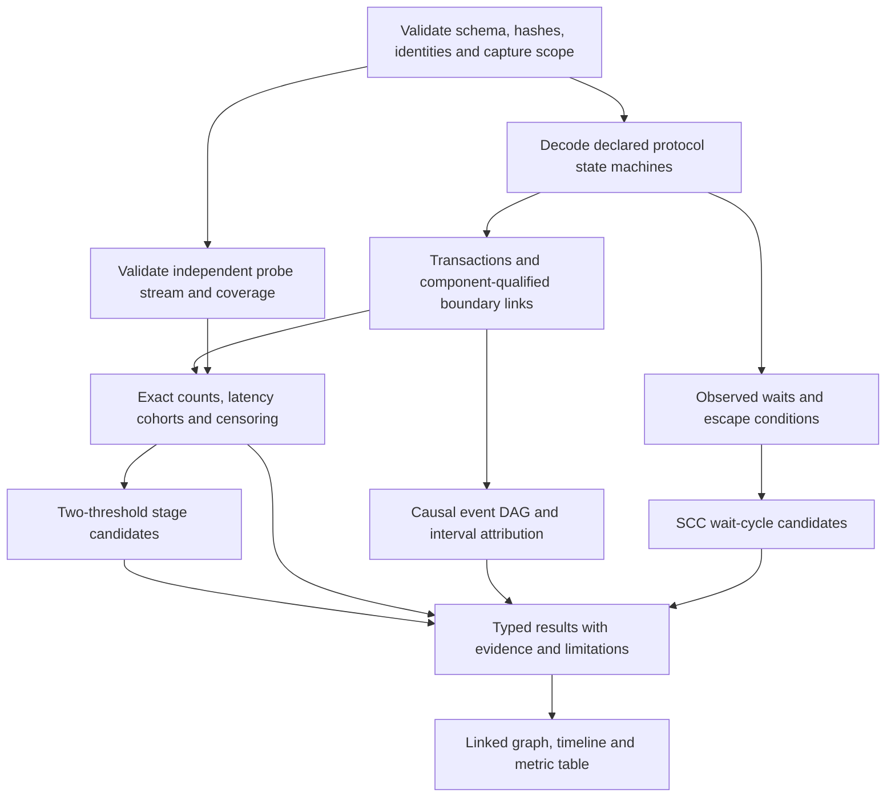
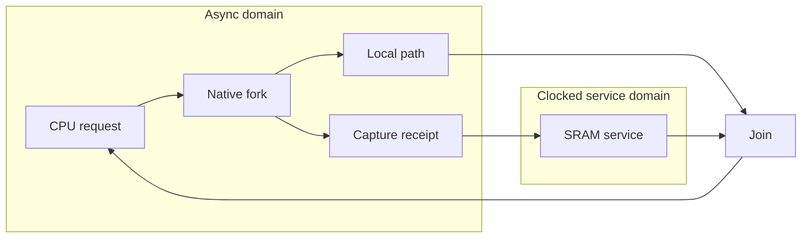
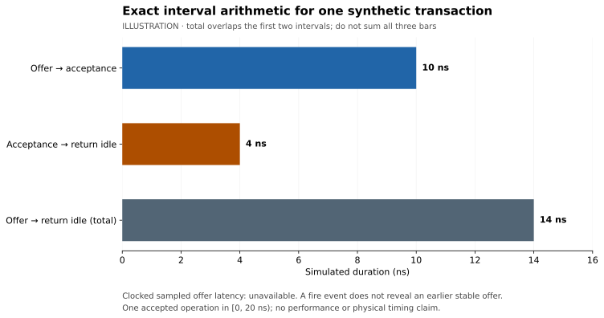

# Flow analysis algorithms and visual design

Research reviewed October 20, 2026. These are implementation choices to test, not measured claims that one algorithm is universally fastest. Primary sources below establish capabilities and theory. Complexity estimates for our proposed pipeline are design analysis. No physical timing or simulator speedup is inferred from these diagrams.

## Decisions and alternatives

| Problem | Initial choice | Alternatives and reason | Cost / evidence boundary |
| --- | --- | --- | --- |
| Decode channel transactions | Deterministic protocol state machine per channel/epoch; hash map for live tokens; stream records in capture order | Payload matching is ambiguous; generic pattern mining cannot establish protocol semantics | Expected O(N) records, O(C+T) live state for C channels/T outstanding tokens; retain outputs/index on disk |
| Correlate across boundaries | Explicit causal IDs, tags or qualified FIFO sequence mappings | Timestamp proximity and equal data are insufficient; vector clocks are unnecessary for one authoritative scheduler | O(N+L) with L explicit links; multi-engine causality remains a separate runtime problem |
| Feedback and graph navigation | Iterative Tarjan SCC, then a condensation DAG | Kosaraju also linear but needs an additional traversal/reverse access; recursive DFS risks stack overflow on large graphs | O(V+E); SCC membership is topology, not simulation settling or deadlock proof |
| Observed end-to-end delay | Topological dynamic programming on an event DAG, with explicit interval/dependency edges | Summing channel latencies double-counts overlap; static longest path through a cyclic circuit is the wrong problem | O(Ve+Ee); missing dependency evidence yields incomplete attribution |
| Waiting/deadlock candidates | Dynamic wait-for graph plus SCC and explicit escape obligations | Idle-time threshold is only a watchdog. Full STG/Petri-net reachability is a separate optional formal tool | Linear graph scan per checked snapshot; AND/OR waits, timers, arbitration and environment escapes require semantic reasoning |
| Exact metrics | Streaming counters and interval integration; exact nearest-rank quantiles from stored samples | KLL sketches later for bounded-memory approximate dashboards; never silently replace exact acceptance metrics | O(N) counters, O(K log K) sorting K latency samples; spill to disk beyond budget |
| Stage bottleneck candidates | `flow.stage-bottleneck@1`: two explicit threshold comparisons on a single-input/single-output stage | High traffic alone is insufficient; causal-DAG attribution remains necessary for complex topology and intervention claims | Streaming interval unions / RLE counts; no opaque score and no proof of root cause |
| Window navigation | Chunk index by physical time and sequence; binary search then bounded scan; prefix counts for aggregates | A generic interval tree is useful only when arbitrary overlapping span queries justify its overhead | O(log B + M) for B chunks and M scanned records; trace size and index byte budgets are measured |
| Graph layout | Prototype ELK Layered for port-aware hierarchy; Graphviz dot for static exports | Force layouts can obscure flow direction and move unpredictably; neither is a semantic authority | Layout cost measured on representative graphs; cache by graph/layout settings and stable IDs |

Tarjan's linear complexity is documented by [Boost.Graph](https://www.boost.org/doc/libs/develop/libs/graph/doc/html/graph/algorithms/connected_components/strong_components.html). Use an iterative implementation or a bounded explicit traversal stack. Keep feedback edges visible after condensation; layout cycle breaking may reverse an edge internally, but it must never change the circuit edge shown to the user.

[Lamport's causality paper](https://www.microsoft.com/en-us/research/publication/time-clocks-ordering-events-distributed-system/) distinguishes causal partial order from a total ordering. Apply that distinction to event records: sequence makes replay deterministic; explicit dependencies establish lineage. [OpenTelemetry links](https://opentelemetry.io/docs/specs/otel/trace/api/#link) are useful precedent for multiple causal relationships. We borrow that concept, not its timestamp representation or an assumption that one parent span describes a hardware join.

[NetworkX's DAG algorithms](https://networkx.org/documentation/stable/reference/algorithms/dag.html) provide a practical independent reference for topological and longest-path checks. The production analyzer need not depend on Python. A small separately written oracle should enumerate paths in bounded acyclic fixtures and compare results; it must not simply call the production algorithm again.

[Workcraft verification](https://workcraft.org/help/verification) explicitly includes environment contracts in deadlock reasoning. A stopped-clock MCU awaiting a legal external event is not necessarily deadlocked. Model waits for all prerequisites separately from waits for any one alternative; a cycle with an external escape remains a candidate. Initial MVP reports wait cycles and deadline violations; proof-level deadlock claims require a qualified closed-state model.

[KLL documentation](https://datasketches.apache.org/docs/KLL/KLLAccuracyAndSize.html) specifies rank error, not absolute error in latency values. If sketches are introduced, reports must name algorithm/version, seed/configuration, rank error and approximation status. A tail with a large gap can have small rank error and large latency-value error. Exact known-answer fixtures remain the acceptance reference.

## Analysis pipeline

Counters alone do not rank bottlenecks reliably. A highly utilized channel may be healthy; a lightly used channel may block critical progress. The default view sorts a selected, explicit metric (for example acceptance wait or blocked duration), displays sample count/censoring, and lets the user inspect causal evidence. No opaque weighted hotspot score in MVP. Throughput, circuit latency and host simulation cost are separate overlays; toggle count is not energy.

For intervention experiments, change one declared parameter, hold workload/seed constant where valid, rerun independent correctness checks, and compare whole-operation latency/throughput. A service-delay parameter that does not change the compiled circuit can be swept across independent sessions in one batch, recording each configuration and seed. Buffer depth changes the compiled model; use separate compiled runs and an explicit model mapping before comparison. Clock policy changes must declare whether they are runtime parameters or structural edits. An observed critical chain does not imply that speeding its largest span improves the system by that amount: concurrency and backpressure may change.

## Stage bottleneck candidates

Proposed rule **`flow.stage-bottleneck@1`** evaluates stage node N with exactly one input channel I and one output channel O over nonempty half-open window W. It is a transparent symptom test, not a root-cause proof or an implemented analyzer. [Graph/probe semantics](graph-event-contract.md#interface-samples-queues-and-waits) define the observations; the [result schema](schemas/analysis-result.schema.json) carries metrics, configuration and findings. The [two pipeline fixtures](examples/pipeline-bottleneck/README.md) provide independent arithmetic and a moved-stage negative control.

| Quantity | Async channel | Declared clocked ready/valid channel |
| --- | --- | --- |
| Backpressure fraction B(C,W) | Duration of the union of offered-but-unaccepted intervals intersected with W, divided by duration of W | Backpressured actual consumer edges in W divided by all sampled consumer edges in W |
| Starvation fraction S(C,W) | Duration in W with no outstanding channel transaction, divided by duration of W | Starved actual consumer edges in W divided by all sampled consumer edges in W |
| Observation count | Number of distinct lifecycle identities intersecting W, with preexisting, aborted and unfinished populations separately disclosed | Number of actual consumer edges represented by RLE intervals, including all four classes |
| Required initial knowledge | Protocol phase/live identities at the window start, or known idle plus complete subsequent commits | Sampling policy, clock-state coverage and exact batch classifications; no invented pre-fire offer |

For async channels an outstanding transaction lasts from offer through completion or abort, including accepted-but-not-returned handshake recovery. Stop offered-but-unaccepted time at acceptance or abort. Clip intervals to W and integrate their union, not a sum that can double-count overlapping intervals. For clocked channels use integer edge counts, not elapsed time, nominal frequency or parent-clock cycles. A hybrid stage may use a time fraction on one side and an edge fraction on the other; the report keeps their bases visible instead of converting one into the other.

N is a candidate exactly when eligible evidence establishes `B(I,W) >= input_backpressure` and `S(O,W) >= output_starvation`. The proposed defaults are **1/2 for each threshold**, inclusively compared as exact rational values. `min_samples` defaults to **1 actual clocked edge** and applies only to clocked fractions; a zero-edge denominator is unavailable regardless of this setting. Async fractions require positive observed duration, not a minimum number of completions. A completely starved async output can have zero transactions and a known starvation fraction of one if its initial state and full window are known. These defaults are inspectable starting points, not calibrated statistical confidence or a steady-state guarantee.

Record the effective thresholds and `min_samples` under the rule's exact version in result `configuration`; hash canonical UTF-8 JSON with lexicographically sorted object keys, compact separators and no trailing newline. Do not infer defaults from an analyzer binary. Reject thresholds outside `[0,1]`, missing configuration or a zero sample minimum. Report both input and output backpressure/starvation metrics for context. **High output backpressure** is an upstream symptom; **high input starvation** is a downstream symptom. Neither alone satisfies the candidate rule. No weighted hotspot score, ranking by hidden weights or `violation` classification is allowed for this rule.

Every candidate references its input backpressure and output starvation metrics, underlying stream evidence and stage/channel IDs. Each metric includes its definition/version, W, basis/unit, integer numerator/denominator, observation count, coverage and left/right/aborted censoring counts. Clocked reports also expose the four class counts and consumer clock. Async right-censored durations can be exact up to W's end when all phase changes are known; a missing completion does not fabricate a latency sample. A known preexisting transaction needs a qualified initial snapshot; an unknown initial phase cannot be treated as no outstanding transaction. The current checker only supports the known-idle fixture subset.

Classification requires complete required evidence for both fractions over the same W. Missing probes, incomplete clocks, unknown initial state, gaps or incompatible definitions yield unavailable metrics or PARTIAL/UNSUPPORTED analysis as appropriate, with **no candidate decision for that stage**. A partial subwindow may be analyzed only as an explicitly different W with its own coverage. Never silently shorten the denominator. Wait vocabulary absence leaves the cause unknown; absent wait probes also leave wait duration unavailable. Neither wait causes nor queue occupancy are reconstructed from the two fractions. Optional supporting details can be unavailable while the two required fractions remain complete.

The scope of `@1` is single-input/single-output stages outside topology feedback SCCs. Forks, joins, arbiters, nodes with multiple data channels, self-loops and feedback regions report their supported metrics but defer classification to the existing explicit **causal-DAG longest-chain analysis** and component-qualified waits. A one-input/one-output node inside a feedback SCC is still excluded. Condensation is for navigation; it does not turn the region into a qualified stage or manufacture causal links. External timers, bursty sources, startup transients and downstream policy can produce the same signature, so a candidate is never a deadlock, physical timing or performance-improvement claim.

The proposed implementation streams per-channel lifecycle intervals and compressed edge counts, retaining coverage/censoring alongside counters. Topology eligibility is computed once using SCC membership and declared node contracts. Queue detail integrates the separate snapshot/operation trace, and waits use component vocabulary. This allows work proportional to captured records plus topology, rather than expanding RLE into one object per clock edge. The fixture validator may inspect individual recorded edges to check references; it is not a production performance prescription.

Acceptance evidence belongs to [FLOW-02/04/05/07](test-plan.md#extension-and-hybrid-flow-analysis-qualification): hand arithmetic, a moved slow stage, missing/paused samples, censored windows and complex-topology exclusions. Passing a shape check or agreement between two shared-code implementations is insufficient.

## Visuals that carry evidence

[ELK Layered](https://eclipse.dev/elk/reference/algorithms/org-eclipse-elk-layered.html) supports ports, orthogonal routing and compound hierarchy. This makes it the first interactive-layout candidate. [Graphviz dot](https://graphviz.org/docs/layouts/dot/) provides directed layered drawings for portable static exports. Benchmark both before taking a packaging dependency; neither is required to run the simulator.

In the viewer, encode domains with borders and labels as well as color. A protocol badge differentiates four-phase, Click and sampled ready/valid. Edge width can show selected traffic rate; color can show a separately selected wait metric, with units/legend. Gray/hatching means unknown or incomplete, never zero. Highlight selected transaction paths and reset epochs; allow feedback/hierarchy collapse without deleting hidden-count summaries.

Graph selection, timeline span and table row share IDs. A hover exposes numerator, denominator, cohort, sample size, capture limitations and evidence links. Cache layout coordinates so changing the time window changes overlays rather than rearranging the circuit. Escape source labels; the plugin supplies data, not executable UI.

This chart comes from the [synthetic fixture](examples/hybrid-flow/README.md): 10 ns to async acceptance, 4 ns recovery and 14 ns total handshake. These intervals overlap by definition; the total is not a third additive stage. The clocked transaction's offer latency is unavailable. The [timeline](images/hybrid-timeline.svg) shows why counting synchronization or valid assertion as acceptance would be falsely optimistic.

## Algorithm qualification and performance experiments

| Experiment | Controls | Report before selection |
| --- | --- | --- |
| Decoder/correlation | Equal payloads, valid withdrawal, out-of-order tagged replies, reset, missing records, native Click parity and stopped clocks | Exact count/lineage agreement with independently authored expected traces; unknown classifications |
| SCC/causal path | Acyclic graph, self-loop, nested feedback, fork/join with shared prefix, tied longest paths, AND/OR escape | Oracle disagreement, stack/memory bounds, deterministic results; no sum-overlap errors |
| Stage candidate rule | Hand-authored async/hybrid pipelines, moved slow stage, paused consumer edges, no sampled edges, burst/startup effects, partial coverage and feedback/fork/join exclusions | Exact fractions, threshold configuration, population/censoring, candidate versus upstream/downstream symptoms; unknown evidence must not become zero |
| Layout | Chains, wide forks, dense feedback, hierarchy, high-degree nodes and disconnected domains; 100/1k/10k nodes plus representative MCU exports | Wall time, peak memory, crossings/overlap, port legibility, stability after filtering and cold dependency cost |
| Streaming/index | 10^4/10^6/10^8 synthetic records where hardware permits; skewed activity, large active frontier and long runs | Capture bytes, decoder throughput, peak resident memory, spill/index cost, window query latency and failed limits |
| Instrumentation | Capture disabled/enabled, optimized/reference scheduler, identical seed/choices | Exact circuit/effect agreement first; overhead separately for capture, storage, analysis and layout |

These sizes are proposed experiment points, not completed benchmarks. Freeze metric definitions and correctness controls before timing. Use repeated runs with hardware/software configuration, raw data and uncertainty; include failures and incomplete cases. Layout experiments may be exploratory, but headline simulator comparisons must follow the [scientific test plan](test-plan.md#scientific-method-and-limits-of-claims).

Start with serial streaming and exact arithmetic. Parallelize across independent captures or proven independent decoder partitions only after profiling. GPU graph analysis and runtime acceleration are separate experiments; neither is justified merely by having a large graph.
