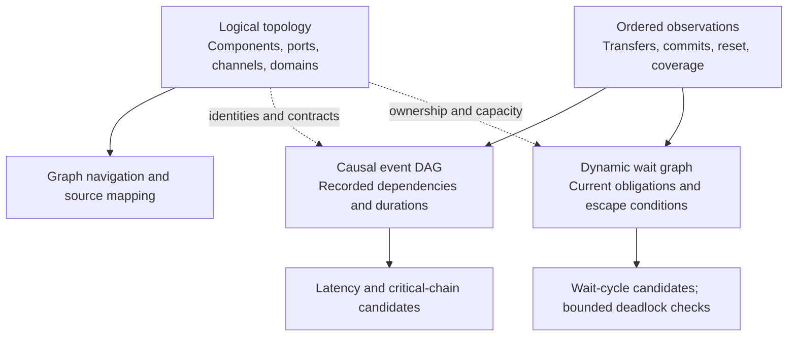
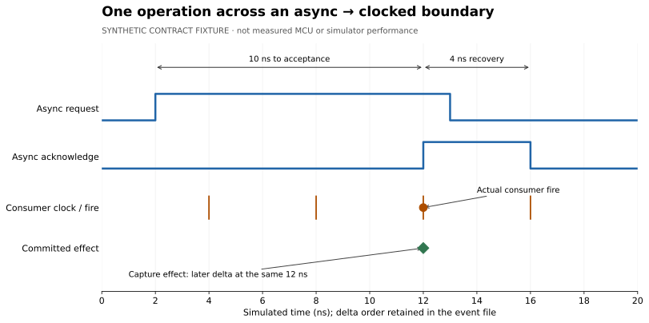
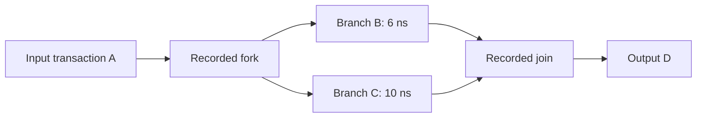

# Logical graph, events and transaction identity

Draft `0.1.0`, October 20, 2026. This public **analysis representation** is not a replacement HDL IR or the runtime execution plan. CIRCT remains the compiler foundation. The [execution semantics](specs/01-execution-semantics.md) and pinned component contracts govern behavior; this document governs recording and interpretation. [JSON schemas and fixtures](schemas/README.md) specify a small executable draft, with cross-record invariants below.

## Three related graphs



Topology may contain feedback. A causal graph over distinct event occurrences must be acyclic. A wait graph describes a particular observed state and depends on the environment. Never use topology cycles as deadlock proof or as instructions to settle arbitrary circuit state to a fixed point.

## Graph record

`design-graph.json` is immutable and carries `schema_version`, `graph_id`, `model_sha256`, `domains`, `nodes`, `channels`, `boundaries` and namespaced `extensions`. [Schema](schemas/design-graph.schema.json).

| Record | Required meaning |
| --- | --- |
| Domain | Opaque ID, kind (`clock`, `reset`, `async`), name; clock records declare active edge. Gate/clock state is dynamic evidence, not a fixed assumed period |
| Node | Opaque ID, hierarchical display path, kind, domain IDs, logical ports and optional source reference (`artifact`, line); display names are not identity |
| Channel | ID, source/sink node+port, exact protocol contract, payload encoding/bit width, owning reset domain, optional clock domain, visibility and declared token capacity or null/unknown |
| Boundary | ID, implementing node, input/output channel lists, contract/version, payload storage slots, reset/effect ownership and causal mapping policy |

Required channels are qualified by protocol IDs: `bd.four-phase.held-return@1`, `click.two-phase@1`, `rv.sampled@1`, or `rv.held-offer@1`. These name analysis contracts, not broad claims to support every library component. A graph must also name the actual boundary implementation/version. Per-component data allowances and hold rules cannot be silently assigned to a stricter profile.

`capacity_tokens` refers to declared channel storage only; `null` means unknown/not applicable. A capture receipt has `storage_slots: 0` even though its channel permits one outstanding handshake. Channel outstanding count and physical buffer occupancy are different metrics.

IDs are unique within a graph, remain stable across analysis passes and never derive from pointers, compiler partition indices or display order. The compiler exporter assigns them from retained logical provenance plus a documented disambiguator; collisions fail. A model hash scopes their meaning. Comparing different elaborations requires an explicit mapping with ambiguous/unmapped entries; identical path names alone are insufficient.

Many source objects may lower to one kernel, and one logical object may be replicated. Keep those execution mappings in a separate overlay. Observations refer to the logical object/effect exactly once. Include only relative source artifact references; source retrieval is host-mediated, not arbitrary path access from a graph label.

## Event envelope and ordering

Each `flow-events.jsonl` line follows the [event schema](schemas/flow-event.schema.json):

| Field | Contract |
| --- | --- |
| `schema_version`, `run_id`, `graph_id` | Exact negotiated schema and owning artifacts |
| `seq` | Contiguous positive decimal string within this capture stream; unique deterministic record order |
| `time` | `fs`: exact decimal string in `0..9223372036854775807`; `delta`: checked uint32; `phase`: `active`, `inactive`, `nba`, `read-write`, `read-only`, or `unknown` for limited imports |
| `kind`, `data` | Closed tagged union; typed payload fields per event kind |
| `evidence` | References to input artifact/probe/commit records; normalized decoder outputs retain their source evidence |

`seq` is the total recording order. Physical time must be nondecreasing. Delta/phase ordering is validated against the scheduler contract, **not an alphabetic sort of phase names**. Reactivation and callback rounds can revisit work at the same physical time. Equal timestamps or adjacent records do not establish causality. Opaque source event IDs can be retained in evidence; capture sequence is not a globally portable source identity.

An import lacking phase/delta knowledge sets phase `unknown` and declares that limitation; its numeric delta placeholder must not be treated as known scheduler order. Such data can support some aggregate counts but not sub-tick latency or phase-sensitive diagnosis. Normalize upstream integer-femtosecond traces exactly; do not infer precision from rounded display timestamps.

The draft normalized vocabulary is `transaction.offer`, `transaction.accept`, `transaction.complete`, `transaction.abort`, `transaction.transfer`, `boundary.link`, `effect.commit`, `clock.edge`, `domain.reset`, and `coverage.gap`. Source-level signal histories, queue observations and wait-reason probes will need separately versioned schemas before broader occupancy/wait metrics are implemented. The current fixture schema intentionally does not pretend to cover that future capture surface.

Native observers publish at semantic commit points before event coalescing; they do not resample only once at the end of a timestamp. Runtime queues and event allocation are unaffected by observer enablement. For parallel kernels, deterministic semantic identities/order must be available before capture is merged.

## Transaction state and protocols

Transaction identity is `(run_id, channel_id, epoch, ordinal)`, with an opaque `transaction_id` attached for references. Decimal ordinals increase per channel/epoch; repeated payloads never reuse an ID. No global cross-clock cycle count exists. Clocked transfers include the observed clock domain and actual edge index; cycles are supplementary local measurements.

| Protocol | Start / acceptance / completion | Essential checks and limits |
| --- | --- | --- |
| Four-phase held-return | `req↑` offers; `ack↑` accepts; return to `00` completes | Legal `00→10→11→01→00`; hold data through return; one outstanding; ack is not automatically a memory effect |
| Native two-phase Click | Request toggle offers; corresponding acknowledgement parity accepts/completes | Snapshot initial parity, enforce one outstanding and declared data hold; reset/rebase contract is component-specific |
| Clocked sampled ready/valid | `transaction.transfer` at active edge with `valid && ready`; start/accept/complete coincide | No per-token offer time before fire without stronger metadata. Report offer latency as unavailable, not zero; sampled blocked cycles are a separate interface statistic |
| Clocked held-offer profile | First qualified offered sample starts token; fire accepts/completes | Require explicit stability/withdrawal rules and checks; do not infer this profile merely from `DecoupledIO` type |

For the held-offer draft, the producer holds valid and payload until fire; consumer ready may vary. This is a named application contract, not an assertion that every `IrrevocableIO` convention is checked. Chisel documents additional Irrevocable conventions and no Decoupled stability guarantees. [Official interface semantics](https://www.chisel-lang.org/docs/explanations/interfaces-and-connections).

The generic lifecycle is `OFFERED → ACCEPTED → COMPLETED` or `OFFERED/ACCEPTED → ABORTED`. Atomic ready/valid transfers traverse the lifecycle in one record. A lost recording yields unknown state, never an invented abort/completion. Abort retains whether acceptance/effects already occurred. At run end pending tokens are right-censored. At mid-run capture start, a snapshot can establish a preexisting token, but its offer latency remains left-censored unless its actual start is retained.

## Crossing a clocked/async boundary

Keep **one transaction per channel**, then record a typed relationship at the boundary's actual transfer point. `boundary.link` contains `boundary_id`, relation, source and destination transaction lists, and earlier causal event references. Contract mappings, explicit tags or observed queue order establish identity. Payload hashes are optional diagnostics, never correlation keys. Reorder-capable interfaces need explicit tags; ambiguous mappings remain unknown.

```mermaid
sequenceDiagram
    participant S as Async producer
    participant B as Capture receipt
    participant C as Clocked consumer
    S->>B: t=2 ns request A; source owns payload
    B->>C: Synchronize request; offer when qualified
    Note over B,C: Sampling alone does not accept A
    C->>C: t=12 ns actual valid and ready edge; transfer B
    C-->>B: Capture observed; link A to B
    B-->>S: t=12 ns, later delta: acknowledge A
    C->>C: Separate effect commit if operation requires it
    S->>B: t=13 ns request returns low
    B-->>S: t=16 ns acknowledge low; A completes
```

This is an **invented contract fixture**, not measured library latency. Its [JSON example](examples/hybrid-flow/README.md) uses exact femtoseconds. Async offer-to-accept is 10 ns; handshake recovery is 4 ns; offer-to-complete is 14 ns. The clocked sampled transaction has no measured offer-to-accept interval. End-to-end effect latency is measured directly from the declared source offer to the effect; adding overlapping channel intervals would double-count waiting.



The reverse `DecoupledToFourPhase` case captures on the clocked input fire, then offers a new async child transaction from stored payload. A later acknowledgement releases its declared slot; it cannot retroactively move the clocked capture time. FIFO mappings use recorded enqueue/dequeue identity. A held payload may be borrowed by a zero-storage receipt; a pending receipt is not a hidden queued copy.

The upstream [bridge contract](https://github.com/BiscutLabs/chisel-async/blob/83d646825da854f93d59f6b2055ecde369e62242/docs/clocked-integration.md) requires the actual consumer clock. A parent clock edge when a consumer gate is closed must not generate a transfer. Record stopped-clock state where available; without it, wait cause is unknown. Independently reset peers and MCU-specific quiescing/rebase behavior need their own qualified mappings.

## Fork, join, arbitration and effects

`boundary.link.relation` is `forward`, `fork`, `join`, `select` or `convert`. Forward/convert/select have one source and one destination; fork has one source and multiple destinations; join has multiple sources and one destination. Multiple parents are essential. A winner at a merge is the selected source only; losers stay pending. Structural edges show possible paths, while occurrence links show the path actually taken.



Concurrent branch service is governed by the slower prerequisite in this simplified example: 10 ns, not 16 ns. Construct an event DAG with non-overlapping duration edges and zero-duration dependency edges; preserve ties and unknown intervals. Its longest observed chain is a bottleneck candidate, not a counterfactual speedup guarantee. [Algorithm decisions](flow-analysis-algorithms.md).

An `effect.commit` has its own `effect_id`, owner node, **effect reset domain/epoch**, operation class and causal transaction/event references. Do not equate channel ACK, architectural retirement and irreversible effect. Deduplicate by effect identity, not by data value. A response may abort while accepted persistent work survives in another reset domain.

```mermaid
sequenceDiagram
    participant A as Application epoch 3
    participant P as POR-owned persistence epoch 0
    A->>P: Accept write; establish effect obligation
    A->>A: Application reset; abort pending response
    P->>P: Write commits under surviving ownership
    Note over A,P: Old transaction is causal history, not an active new-epoch response
```

Reset observations name the domain and new epoch. Affected open transactions terminate under the declared channel policy, then any new transaction uses the new epoch. Cross-reset causal references are permitted only by an explicit retained-owner boundary contract. The schema can represent these relationships; the component validator must establish their legality. Reset cannot erase committed effects or silently preserve unsupported work.

## Coverage and metrics

The [capture manifest](schemas/capture-manifest.schema.json) identifies artifact hashes/bytes, requested scope, observation window, initial-state knowledge, phase precision, producer version and gaps. A complete capture means all records required by its declared scope were retained. Unknown/unobserved channels cannot be painted idle. Required records are lossless: use bounded backpressure or stop with an explicit error. Imported partial records can support only separately qualified subsets.

Use half-open windows `[start,end)`. Count offers/acceptances/completions by their own occurrence times. Acceptance rate is `accepted_count / observed_duration`, with explicit units. Latency distributions use a declared **offer cohort**, retaining pending, aborted, preexisting and missing observations separately. Clocked sampled transfers are not artificially given zero offer latency. Overflow, negative durations, inconsistent clocks, duplicate IDs and missing causal references fail validation.

Exact quantiles use sorted samples and nearest rank `ceil(p*N)` for `0 < p <= 1`, minimum for `p=0`; no interpolation. Report sample count and censoring. Occupancy requires initial occupancy plus actual enqueue/dequeue events and capacity; it is not inferred from phase duration or token count. Unknown time segments are excluded with their duration disclosed, not counted as empty. Wait reasons require probes and component contracts, not signal-name heuristics.

The worked fixture includes an [expected result](examples/hybrid-flow/expected-result.json) and [chart](images/hybrid-metrics.svg). They are hand-authored arithmetic controls, not MCU benchmarks or simulator performance evidence.

## Validation obligations

JSON Schema checks record shapes; the semantic checker checks ID uniqueness, references, time ranges/order, supported lifecycle transitions, reset epochs and selected arithmetic. Production decoding additionally requires raw observation correctness, domain/sample semantics, primitive mappings, effect ownership, coverage, deterministic replay and instrumentation transparency. Those are release gates, not claims made by the draft validator.

Required adversarial cases include identical payloads, valid withdrawal without fire, paused/gated clocks, negative/missing/duplicate events, reset at every phase, accepted persistent work across application reset, initial tokens, fork/join overlap, reordering tags, capture gaps and >2^53 timestamps. Pure clocked, pure async and all four directional compositions must pass independently.
