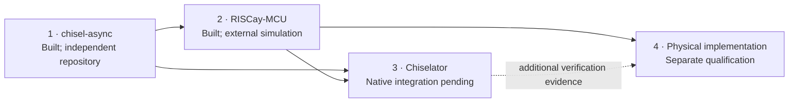

# Stack status and integration baseline

Reviewed October 20, 2026 against local clean checkouts. This is a source/document inspection, **not a rerun of upstream qualification**. Exact test receipts and release claims remain in each owning repository. Chiselator has design documents and draft contract fixtures; its simulator, plugin host and analyzer are not implemented.

| Product | Observed baseline | What exists | Chiselator work remaining |
| --- | --- | --- | --- |
| [chisel-async](https://github.com/BiscutLabs/chisel-async) | [`83d646825da854f93d59f6b2055ecde369e62242`](https://github.com/BiscutLabs/chisel-async/tree/83d646825da854f93d59f6b2055ecde369e62242) | Published 0.1.0-RC1 artifacts; RC2 development, four-phase composition, native Click, bounded dual-rail families, clocked bridges, timing/export contracts and external tests | Import the pinned contracts and probes; qualify each native primitive, protocol and boundary independently |
| [RISCay-MCU](https://github.com/BiscutLabs/RISCay-MCU) | [`870124a93c5e9ed86f2ca52a45c4f24bdb8851d6`](https://github.com/BiscutLabs/RISCay-MCU/tree/870124a93c5e9ed86f2ca52a45c4f24bdb8851d6) | RV32E core, four-phase BD and native Click variants, boot/firmware, peripherals, executable tests and physical development artifacts | Freeze reproducible exports, firmware and independent expected effects; run equivalent native Chiselator acceptance campaigns |
| Chiselator | This repository | Architecture, qualification plan and draft analysis contracts | Compiler/runtime vertical slice, native integration, plugin host, analyzer, viewer and release qualification |
| Physical implementation | MCU-owned parallel development | GF180 development and a documented completed BD route at an older revision | Electrical/timing/SI and fabrication qualification remain separate; FPGA target is Vivado |

The MCU pins the exact library commit above through `project/chisel-async-source.json` and an sbt Git source dependency. A sibling checkout or `publishLocal` is not required. RC1 package evidence must not be presented as qualification of every RC2 development commit. Upstream library documentation records Windows/Linux campaigns and defers macOS; Chiselator's proposed three-platform release matrix is still a separate obligation.

The original four-step order describes product responsibilities. Physical exploration has since started upstream; it does not become a prerequisite for simulation. No PDK, Yosys, Vivado or routed chip is required to develop or run Chiselator. A routed older design does not establish timing closure or qualify current MCU RTL.

## Integration inputs and ownership

| Owner | Authoritative inputs | Consumer obligation |
| --- | --- | --- |
| Library | [Compatibility](https://github.com/BiscutLabs/chisel-async/blob/83d646825da854f93d59f6b2055ecde369e62242/docs/compatibility.md), [timing/export](https://github.com/BiscutLabs/chisel-async/blob/83d646825da854f93d59f6b2055ecde369e62242/docs/timing-and-export.md), [clocked integration](https://github.com/BiscutLabs/chisel-async/blob/83d646825da854f93d59f6b2055ecde369e62242/docs/clocked-integration.md) | Validate source contract version, semantic hashes, port/probe ABI and declared primitive behavior before lowering |
| MCU | [SoC contract](https://github.com/BiscutLabs/RISCay-MCU/blob/870124a93c5e9ed86f2ca52a45c4f24bdb8851d6/docs/soc-contract.md), [build/tests](https://github.com/BiscutLabs/RISCay-MCU/blob/870124a93c5e9ed86f2ca52a45c4f24bdb8851d6/docs/build-and-test.md), [test cleanup](https://github.com/BiscutLabs/RISCay-MCU/blob/870124a93c5e9ed86f2ca52a45c4f24bdb8851d6/docs/test-suite-cleanup.md) | Pin variant, profile, firmware, clocks, resets and oracle revision; distinguish static export audits from executed behavioral evidence |
| Simulator | [Six specifications](specs/README.md), [test plan](test-plan.md) | Demonstrate semantic agreement, repeatability and instrumentation transparency; retain unsupported capabilities explicitly |
| Analysis | [Plugin API](plugin-api.md), [graph/event contract](graph-event-contract.md) | Retain exact time, evidence, coverage and ownership across protocol boundaries |

The library's `contract-v3.schema.json` and `trace-v1.schema.json` are upstream formats, **not aliases** for Chiselator's graph/event schemas. Write an explicit versioned adapter. Its trace v1 carries integer femtoseconds but does not by itself establish every scheduler phase or cross-component causal relationship. Never manufacture the missing information.

## Next acceptance slices

1. Freeze one clocked fixture, a four-phase pipeline and both directions of a clocked bridge, with independently calculated expected traces.
2. Preserve typed export identities through CIRCT and bind primitives without erasing delay or state semantics.
3. Qualify four-phase decoding and actual consumer capture, then native two-phase Click decoding and receipts. Click is required for the second MCU variant; a four-phase-only milestone is explicitly partial.
4. Run MCU boot, memory/MMIO, wait/wake and reset/persistence cases against independent retirement/effect references. Add application firmware profiles separately.
5. Qualify analysis capture and plugins against the same runs, then release packaging. Upstream passes are inputs to these gates, not substitutes for them.

The following are **requested upstream dependencies**, recorded October 25 for the proposed [probe contract](graph-event-contract.md#interface-samples-queues-and-waits). They do not claim a newer inspection of the pinned library. chisel-async owns the names, semantics and ABI; this task does not edit that repository or prescribe concrete probe names.

| Upstream chisel-async ask | Chiselator needs | Qualification dependency |
| --- | --- | --- |
| FIFO enqueue/dequeue/occupancy probes | Stable storage identity/capacity, exact initial occupancy and resident token identities, committed enqueue/dequeue identity/order, and explicit reset behavior | Bind the library's declared ABI, compare raw observations with an independent queue trace, then qualify snapshot integration and capture transparency |
| Per-component wait vocabularies | Versioned reasons and obligation identity for supported components, with begin/end, overlapping obligations, reset and initial-state rules; absent reason remains unknown | Import the authoritative vocabulary instead of inferring names; qualify known, unknown and unsupported cases against independent component tests |
| Probe ABI and export preservation | Machine-readable versioned declarations linking storage/obligations/interfaces to source and lowered bindings; actual consumer-edge/polarity and clock-state availability; compatibility/semantic hashes | Preserve requested observation points through CIRCT/optimization and reject an incompatible executor or analysis request explicitly |

Chiselator cannot qualify these runtime captures until upstream exposes the contracts/probes and independent fixtures. The local three-bundle kit only validates hand-authored normalized records; synthetic `fixture.*` vocabularies are not library API proposals. Core simulation does not depend on installing the analysis plugin, and missing optional detail must not invent healthy metrics. Required bottleneck observations that cannot be bound make the requested analysis UNSUPPORTED.

Historical library build milestones and old MCU capacity estimates have been removed from active simulator guidance. Their history remains in Git and the owning repositories; do not maintain a second component backlog here.
