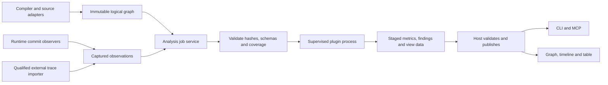
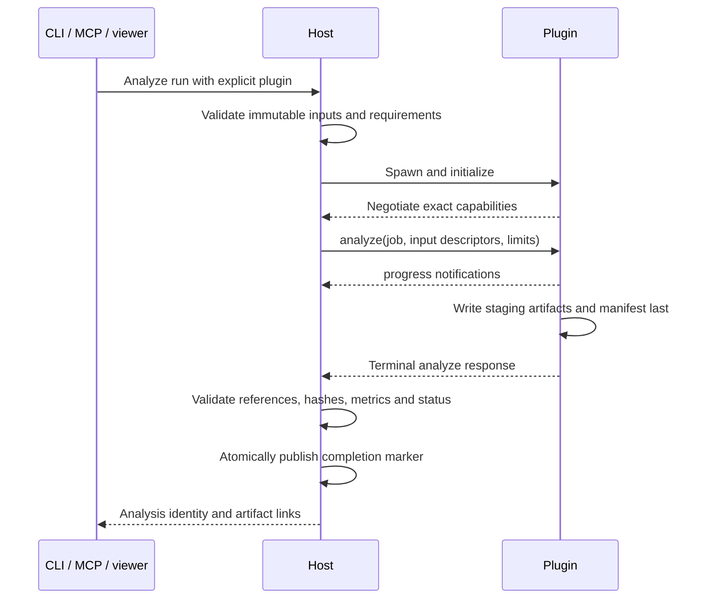

# Analysis plugin API

Draft `0.1.0`, October 20, 2026. This specifies a proposed **local, read-only, offline analysis API**, not an implemented host. The [extension overview](extensibility-flow-analysis.md) owns product scope; the [graph/event contract](graph-event-contract.md) owns data semantics. Execution backends and primitive bindings remain separate compiler/runtime interfaces.

## Architecture and responsibilities



| Component | Owns | Must not do |
| --- | --- | --- |
| Capture/export adapters | Semantic identities, actual event commits, exact timing, coverage and provenance | Infer transfer lineage from matching payload values |
| Host | Installation registry, negotiation, input validation, jobs, limits, cancellation and publication | Treat a plugin's success exit code as sufficient evidence |
| Decoder | Versioned protocol state machine and qualified component mapping | Invent a sampling edge, reset policy or hidden buffer |
| Analyzer | Metrics and evidence-backed findings over normalized events | Change circuit state or silently turn partial data into complete results |
| Viewer | Declarative views of validated artifacts and source references | Execute plugin-provided HTML/JavaScript or fetch remote resources implicitly |

A plugin may implement decoder, analyzer or exporter roles, advertised separately. The first-party flow analyzer uses this same process API; a tiny independent JSON/CSV exporter is the interoperability check. Rust is the default shipped implementation, but any language can implement the wire contract. Third-party runtime requirements are explicit and do not become dependencies of the base package.

## Packaging and trust

The [manifest schema](schemas/plugin-manifest.schema.json) declares `id`, package version, exact API versions, artifact versions, roles, required capabilities and an entrypoint per OS/architecture. Entrypoints are package-relative executables with an argument array. The host registry records the package hash and user-enabled identity. Imported graph files cannot install or launch plugins.

Use native process spawning, without shell command construction. Resolve package paths and staging outputs under their allowed roots; reject absolute/traversal paths and escaping symlinks/reparse points. Apply executable/manifest hashes at launch. These checks protect artifact handling; **a local process is not an OS security sandbox**. Initially plugins are explicitly trusted installed code. True untrusted execution requires a separately designed sandbox.

Inputs are immutable files in a host-created job directory, named by relative artifact path plus SHA-256, byte length and media type. The host grants a staging output directory. No network access is required by this API; it does not claim to prevent trusted code from using the network. A plugin cannot request simulation mutation, raw pointers, MLIR objects or access to host credentials through this interface.

## Transport and version negotiation

Use [JSON-RPC 2.0](https://www.jsonrpc.org/specification) over UTF-8 stdio, one compact JSON object per LF-terminated line; CRLF is accepted. No BOM, batches or JSON-RPC `rpc.*` methods. Stdout is protocol-only, stderr is bounded diagnostic text. String request IDs are unique per process. Notifications have no `id` and receive no response.

Initial limits: 1 MiB per control frame, one active analysis per process, 10 seconds for initialization, 5 seconds for cooperative cancellation, 100 messages/second per process with progress coalescing. Job wall-time/output limits are explicit in `analyze`; values are recorded and configurable. Large graphs/events/results travel in files, never JSON-RPC or MCP messages. Integer simulated times and potentially large counters use decimal strings.

During draft development **negotiate exact versions**, including `0.1.0`; no SemVer compatibility inference. Unknown required capabilities or versions fail before analysis. A future stable minor version may allow additions only under published compatibility rules. Optional namespaced metadata belongs in `extensions`; closed core records reject unknown fields. Unknown event kinds cannot be skipped while claiming complete affected metrics.

| Direction / method | Required parameters | Result / obligation |
| --- | --- | --- |
| Host → `initialize` | `api_versions`, host version, requested role, supported artifact versions, resource limits | Selected `api_version`, plugin id/version, supported capabilities, schemas and deterministic-analysis declaration; host verifies against installed manifest |
| Host → `analyze` | `job_id`, input artifact descriptors, output directory, half-open window, configuration, requested metrics, required coverage/capabilities and limits | Exactly one terminal response with status, staged result descriptor and structured diagnostics; no artifact bytes in the response |
| Plugin → `progress` notification | `job_id`, monotonic `processed_records` string, optional total, phase | Advisory only; neither progress nor a percentage establishes coverage |
| Plugin → `diagnostic` notification | `job_id`, code, severity, bounded text, optional evidence reference | Retained with the job; no unsolicited action requests |
| Host → `cancel` notification | `job_id`, reason | Idempotent; finish `analyze` with `CANCELED` within grace period, otherwise host terminates/reaps the process tree |
| Host → `shutdown` | Empty object; no active job | Empty result, then clean exit within grace period |

Errors use JSON-RPC standard codes for parse/envelope/method/parameter failures. Application codes: `-32010 INCOMPATIBLE`, `-32011 INVALID_ARTIFACT`, `-32012 MISSING_CAPABILITY`, `-32013 LIMIT_EXCEEDED`, `-32014 ANALYSIS_FAILED`. Structured `error.data` contains stable `reason`, optional artifact/evidence and retryability. An accepted job records a terminal host result even if a malformed response or process crash prevents a valid plugin response.

```json
{"jsonrpc":"2.0","id":"init-1","method":"initialize","params":{"api_versions":["0.1.0"],"host_version":"0.1.0-dev","role":"analyzer","artifact_versions":{"graph":["0.1.0"],"event":["0.1.0"],"capture":["0.1.0"],"result":["0.1.0"]},"limits":{"control_frame_bytes":1048576}}}
```

This is an illustrative control request, not a working command. The initial SDK must include generated types, line framing, lifecycle helpers and conformance transcripts for valid/error/cancel/crash exchanges. Schemas alone do not implement this RPC layer.

## Lifecycle and publication



Job states are `CREATED → VALIDATING → STARTING → RUNNING → PUBLISHING → TERMINAL`. Cancellation may interrupt any nonterminal state. The host arbitrates a cancellation/finish race by its recorded job order: after accepting cancellation it never publishes a new `COMPLETE` outcome for that job. Preserve useful artifacts under `CANCELED`, `PARTIAL` or `ERROR` with an actual processed frontier.

Terminal analysis statuses are `COMPLETE`, `PARTIAL`, `UNSUPPORTED`, `CANCELED`, `ERROR`. Simulation PASS/FAIL remains independent. A required-analysis regression gate accepts only complete compatible evidence and its configured findings policy. `COMPLETE` describes the requested analysis scope, not whole-design visibility or circuit correctness.

Publish outputs only after schema, reference, size, hash and required-coverage checks. Incomplete staging directories are never cache hits. An interrupted host records an abandoned job on recovery. Use native process-tree cleanup on Windows, Linux and macOS; POSIX signals alone are insufficient.

## Results, deterministic reuse and integration

The [result schema](schemas/analysis-result.schema.json) defines status, provenance, metrics and findings. Each metric carries definition/version, scope, interval, unit, numerator/denominator or exact value, sample count and coverage reason. `unknown` is not numeric zero. Findings contain rule/version, evidence IDs, assumptions and classification (`observation`, `candidate`, `violation`); severity does not upgrade causal certainty. A rejected result never appears as a successful report.

The cache key includes exact graph/capture hashes, plugin package and configuration hashes, decoder/metric/schema versions, requested window/capabilities and deterministic seed if used. Canonicalize result JSON before hashing; omit host paths, wall-clock timing and log order from the semantic digest. Record those separately as diagnostics. Do not reuse partial/canceled results as complete. Re-analysis is not simulation replay.

Planned CLI commands are `plugins list/inspect`, `analyze`, `analysis inspect/export/compare`. MCP calls the same job service and returns bounded summaries/artifact references. No MCP dependency enters the plugin protocol. The local viewer consumes graph IDs and event references; selection must agree across graph, timeline, tables and exported reports.

## Implementation sequence and release gate

1. **Contract kit (this draft):** schemas, hand-authored examples, selected cross-record checks and negative controls. It is not full protocol conformance.
2. **Host/SDK:** RPC framing, negotiation, crash/cancel/limits/publication on all native targets; first-party analyzer stub plus separately written exporter.
3. **Decoder/metrics:** four-phase and clocked transfer tracking, boundary receipts, then native Click; exact known-answer arithmetic and reset/effect fixtures.
4. **Capture/viewer:** immutable runtime observations, transparency comparisons, stable graph IDs and linked views.
5. **MCU qualification:** both MCU variants, stopped clocks, boot/MMIO, reset and persistent effects, with independent expected outcomes and measured capture overhead.

PLG-01–04 and FLOW-01–08 in the [test plan](test-plan.md#extension-and-hybrid-flow-analysis-qualification) remain the release gates. Plugin availability must never become a prerequisite for core simulation.
