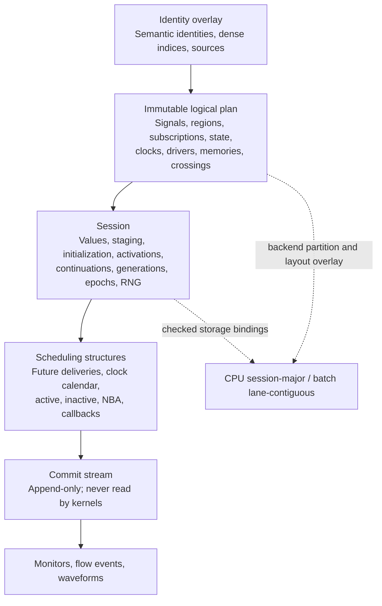

# 06 — Execution data model

Draft, revised October 25, 2026. Status and scope: [specification index](README.md). This specification defines the storage and scheduling representation implementing [execution semantics](01-execution-semantics.md) and refining the [immutable plan interface](02-compiler-runtime-interface.md#immutable-plan). **Specification 01 governs observable behavior; if the documents disagree, 01 wins and this document must change.** CIRCT remains the compiler foundation. The simulator and production layouts below are not implemented.

One logical model serves clocked, clockless and hybrid designs without a global cycle or fixed time step. Exact timed deliveries coexist with inexpensive region activations and ordered current-time effects. Clocked samplers do not need one future event per register; async logic does not need a future event for every zero-delay change. Backends choose physical layouts while preserving the same circuit behavior.

## Layers



| Layer | Lifetime and sharing | Kernel access |
| --- | --- | --- |
| Identity overlay | Compiled artifact, shared across runs | Stable IDs/order keys through checked bindings; no source-graph traversal |
| Logical plan | Compiled artifact, shared by sessions and backend variants | Read-only checked bindings |
| Backend partition/layout | Immutable artifact metadata plus executor-owned prepared bindings | Generated addressing and declared kernel entry points |
| Session state and scheduling | One run, including device-resident state | State within declared permissions; scheduling through helpers |
| Commit stream and monitor state | One run, bounded streaming storage | Append through validated helpers; never read as circuit input |

The diagram describes ownership and data flow, not an instruction to delay all observations until settling. Observers attach to required commit points.

## Identity

Checked dense indices, initially `u32`, address plan tables. Semantic IDs identify channels, constraints, effects, primitives and source objects in the [graph record](../graph-event-contract.md#graph-record). They are not interchangeable. The overlay supports splitting/replication and fusion, with explicit one-to-many and many-to-one provenance. Effects and observations retain one logical owner; pure replicas cannot multiply them.

Indices are stable only within their artifact/layout variant. Cross-artifact comparisons require an explicit logical mapping. Backend indices, allocation addresses, workers and GPU lanes cannot select event order or random choices. Index/count conversion overflow rejects the variant before truncation.

## Immutable plan and backend layout

Hot tables use dense arrays and compressed sparse row (`Csr`) adjacency. Structure-of-arrays is a candidate for hot fields, not a requirement for every cold metadata record. The following Rust sketches describe ownership and required information, not public ABI types or compilable declarations.

```rust
struct Plan {
    signals: SignalTable,        // width, signedness, logical slot, owner, subscriber range
    subs: Vec<Subscription>,
    regions: RegionTable,        // kind, input/output ranges, effects, activity, rank, class
    state: StateTable,           // kind, cur/optional next slots, init policy, reset owner
    clocks: Vec<ClockSource>,
    drivers: DriverTable,        // destination, delay/cancel rule, semantic ordering owner
    memories: MemoryTable,       // geometry, ports, clocks, latency, collision policy
    processes: ProcessTable,     // continuation schema and static wait-site descriptors
    crossings: Vec<Crossing>,
    observe: ObservationPlan,
    channels: Vec<ChannelMonitor>, // protocol/signal bindings; monitors only
    ids: IdentityOverlay,
}
struct BackendVariant {
    partitions: PartitionOverlay,
    kernels: KernelBindings,
    layout: BackendLayout,       // logical slots -> checked offsets, alignment, strides
}
struct Subscription { pred: Pred, target: Target }
enum Pred { Change, Posedge, Negedge, High, Low }
enum Target { Region(RegionIdx), WaitSite(WaitSiteIdx), Monitor(MonitorIdx) }
enum RegionKind { Pure, Sampler, Process, Primitive }
enum ClockPolicy {
    Managed { high_fs: u64, low_fs: u64, pausable: bool },
    SignalDriven,               // includes derived/gated clocks; no synthetic edges
}
struct Crossing {
    signals: CsrRange<SigIdx>,
    producer: ClassId,
    consumer: ClassId,
    sample_edge: Option<SubIdx>,
    lookahead_fs: u64,           // conservative proven lower bound; zero unless established
    proof: Option<ConstraintRef>,
}
```

| Record | Required invariant |
| --- | --- |
| Signal | One authorized logical writer under the supported policy; delayed writes may reference that writer without becoming independent drivers. Unsupported multi-driver resolution fails. Width/signedness/masking are explicit; physical word offsets belong to the backend layout |
| Region | One of spec 02's four kernel kinds, complete input dependencies, declared effects and kernel binding. `Pure` regions cannot perform scheduler/state/external effects; their declared outputs/change information are permitted. Topological rank applies only within a proven acyclic pure cone |
| Subscription | Complete relevant signal dependencies, including slices/edge predicates. Static wait sites are bound to session-owned live registrations and generations. `High`/`Low` tests are also evaluated when a wait is armed, so an already-satisfied condition is not missed |
| State | Edge-sampled state has current and owned staging slots. Latches/C-elements/mutexes have current and any contract-declared private state; no universal next-state swap. Required primitive state has initialized status |
| Clock | Positive representable managed durations; source signal and actual eligible edges. A gated/derived signal triggers sampling only when that signal transitions |
| Driver | Explicit delivery/cancellation policy and owner. Eligible zero-delay pure assignments use region outputs; delayed assignments and timed effects use driver/delivery descriptors. A newer transport write does not cancel an older one |
| Process | Frame size/alignment and wait-site schema are checked by the backend layout; dynamic registrations and captured values are session-owned |
| Crossing | Compiler-derived region/class boundary with endpoint provenance. It adds no state, buffer, ordering or transaction identity |
| Observation plan | Requested transitions/commit points must survive optimization; reject an incompatible variant |
| Channel monitor | References circuit/probe bindings and reset contracts; kernels cannot read derived monitor state |

An execution class is a scheduling/partition grouping with declared clock/async dependencies, not a new hardware clock or an independence proof. A region may depend on several domains. Topological rank or class number cannot override process order, phase order or stateful feedback semantics. Stateful async feedback uses qualified primitives/processes; SCC detection alone cannot choose its behavior.

Region size is compiler policy: a GSIM-style pure supernode, a small async cone, a primitive binding or a process. Backend replication/fusion preserves logical dependencies and exactly-once effect ownership. If Arc owns physical state allocation, its offsets are described by the layout overlay rather than forced into a second allocation.

## Per-session storage

```rust
struct Session {
    now: TimePoint,               // exact i64 femtoseconds, checked delta, current phase
    values: Words,                // current signals/state; width-masked
    memories: MemoryArenas,
    next: StagingBuffers,         // values, write masks and sampling-batch ownership
    initialized: BitSet,
    activity: RegionActivity,     // pending bits, summary words, optional per-region generations
    continuations: AlignedArena,
    waits: WaitRegistrations,
    generations: GenerationTables, // typed owners: driver, wait registration, managed clock
    clocks: Vec<ClockState>,      // running/paused, next edge, polarity
    reset_epochs: Epochs,
    rng: KeyedCounters,
    crossing_dirty: BitSet,       // per crossing/consumer; conservative optimization hint
    sched: Scheduler,
    observation: ObservationState, // commit stream, monitors and coverage state
}
```

State exists continuously between events. `next` is staging for a particular normalized sampling batch, including supported sampled ports where required. Behavioral processes retain their assignment/NBA semantics; they are not automatically double-buffered. Memories and aligned continuation frames remain session-owned on every backend. The initial CPU layout may use a `u64` for values up to 64 bits and masked multiword storage above that; narrower native storage is a qualified layout optimization.

Pending transitions reside in the scheduler, which **is part of resumable session state**. They are not duplicated in the circuit-value arrays. Primitive state can retain cancellation generations/handles, but not a second authoritative pending payload. Current-time queues, captured payloads, staged writes and wait registrations must survive budget stops and any future checkpoint contract.

Generation owners are typed: decoding a tagged target selects the correct driver, wait or clock table. A single unchecked generation index cannot alias these namespaces. Use consume-before-run or per-region generations to preserve reactivation; a global per-slot marker cannot suppress later work in the same slot. Checked generations, epochs, order counters and deltas never wrap and revive stale work.

Use a versioned counter-based random generator with the keys required by [spec 05](05-artifacts-compatibility.md#replay-and-random-choices): algorithm version, user seed, stable session identity, semantic object and decision kind. Advance its counter only at the specified model decision. Known-vector tests must agree across native/device implementations. Compaction moves the counters with the session; lane number never becomes a key.

Protocol phase, per-channel ordinals and live tokens are monitor state derived from commits. Actual bridge state remains RTL/qualified primitive state. Monitor epochs follow observed circuit reset domains; monitors cannot reset the circuit or discard an accepted persistent effect owned by another domain.

## Two dispatch mechanisms

The distinction is between future-time delivery and current-time dispatch. Current-time dispatch includes both coalescible bits and ordered work; it is not universally one bit per region per timestamp.

| Mechanism | Meaning | Coalescing and storage |
| --- | --- | --- |
| Future event | Captured delayed write, timed wakeup, scheduled harness drive or external injection | Preserve every required delivery except explicit cancellation/filtering; general future queue |
| Managed edge | One clock signal transition at an exact time | Separate calendar, or equivalent event representation; no per-register future entries |
| Pure activation | Recompute an eligible pure region from its inputs in this evaluation round | Pending bit/worklist entry may coalesce until consumed; later reactivation survives |
| Ordered current-time work | Edge occurrences, sample batches, process resumes, primitive transitions, inactive work, NBA and callbacks | Preserve required order/multiplicity under their contracts; use slot worklists and staging |

A zero-delay req/ack chain can avoid all future-queue entries while still requiring ordered primitive/process work. A transport delay line schedules one captured delivery for each input transition; inertial suppression follows its distinct contract. A managed clock occurrence changes one signal and dispatches its sampler group. An explicitly delayed register/NBA write remains a timed obligation; the no-per-register-event optimization applies to normalized zero-delay sampling. Derived/gated clocks follow actual signal transitions with no synthetic periodic event.

Consume activation before evaluation and notify subscribers when outputs change; always-run regions still activate tracked consumers. **Coalescing a wake request cannot erase a required pulse, edge or effect.** Preserve trigger/commit information even if the current value is later overwritten. Repeated derived edges at the same physical timestamp may need distinct sample batches. Stateful/process wakeups coalesce only when their own semantics permit it. Do not force a waiting process to execute between another process's consecutive blocking statements merely to preserve a pulse; retain the trigger and follow spec 01's process/phase rules.

Full-scan mode retains trigger conditions and executes effects exactly once. Pure-region fusion can discard intermediate values only when neither circuit semantics nor the requested observation policy requires them.

## Scheduling structures

A logical delivery carries physical time, a semantic producer/order sequence, a typed destination and delivery class, a cancellation identity and captured payload. The baseline may use wider fields. The following **optional compact encoding** packs the kind tag into the destination, making a 32-byte record possible:

```rust
#[repr(C)]
struct CompactEvent32 {
    ticks: i64,
    order: u64,        // high 32: semantic order-key index; low 32: local sequence
    target: u32,       // high 4: validated tag; low 28: target-table index
    generation: u32,   // checked token of the decoded cancellation owner
    payload: u64,      // inline captured value or validated payload-arena offset
}

const _: () = {
    assert!(std::mem::size_of::<CompactEvent32>() == 32);
    assert!(std::mem::offset_of!(CompactEvent32, ticks) == 0);
    assert!(std::mem::offset_of!(CompactEvent32, order) == 8);
    assert!(std::mem::offset_of!(CompactEvent32, target) == 16);
    assert!(std::mem::offset_of!(CompactEvent32, generation) == 20);
    assert!(std::mem::offset_of!(CompactEvent32, payload) == 24);
};
```

This is a backend encoding candidate, not the public file format or a frozen ABI. Record alignment/byte order in the layout and test the matching C/device consumer. `repr(C)` alone does not establish cross-target calling compatibility. [Rust layout rules](https://doc.rust-lang.org/reference/type-layout.html#reprc-structs).

The encoding has explicit obligations:

- Tags define destination class, delivery work class and payload interpretation through a versioned descriptor. Unknown tags, wrong target kinds or indices beyond the 28-bit range reject the record. Mask/decode `target` before indexing a table; do not use the tagged value as `generations[target]`.
- The high order-key index refers to a deterministic, semantic-order-preserving producer map. The local sequence belongs to that producer/session, not a worker or observation stream. Validate plan-time capacity before compilation; deterministic tie-breaking never legitimizes conflicting unordered writes.
- Check runtime sequence/generation exhaustion **before scheduling or canceling**. The initial compact path stops with an explicit limit diagnostic; use a wider encoding for long runs where required. Silent wrap, reset-at-each-timestamp and ad hoc renumbering are forbidden. A future rebase/extension scheme must preserve the ordering and cancellation identities of all live queued work, waits and external references before it can be qualified.
- Wide payload offsets have checked size, alignment, lifetime and width masking. Capture values when scheduled; delivery cannot reread the source. Reclaim payloads only after no live delivery references them.

```rust
struct Scheduler {
    future: EventQueue,            // binary heap baseline; exact typed deliveries
    clock_cal: ClockCalendar,      // one next occurrence per managed clock
    ready: SlotWorklists,          // pure activations plus ordered process/edge/primitive work
    inactive: InactiveWork,        // generation-checked #0 resumptions
    nba: OrderedStagedWrites,     // captured NBA writes and normalized sampler batches
    callbacks: CallbackQueues,
    payloads: CapturedPayloadArena,
}
```

Future records do not preassign delta. The slot state machine assigns the execution frontier when installing/processing work. A delayed NBA retains its delivery class. Sorting `(time, delta, phase)` cannot replace phase re-entry. Observation `seq` is a separate capture-stream identity.

Validate cancellation **before any value write, trigger or observation**. Stale records are discarded under their owner's rule. Managed clock pause invalidates future edges only; transport transactions survive newer writes unless an explicit reset/cancellation contract says otherwise. Preserve the [delay-line equality rule](03-async-model-contracts.md#primitive-library): a delivery already due at the current timestamp belongs to the due-driver batch before reactions create replacement candidates.

## Region execution and hybrid scheduling

The following realizes [spec 01's scheduling cycle](01-execution-semantics.md#time-and-event-ordering), not a substitute SV scheduler:

1. **Resume or choose time.** If stopped inside a slot, resume its existing queues first. Otherwise choose the earliest live obligation across future queue, clock calendar and required external/callback frontiers, bounded by the authorized run limit. Discard stale heads safely. No-next-event is optional, not a sentinel. An idle `run_until(T)` advances to T; actual deliveries at T are processed inclusively before returning.
2. **Install due work.** Validate tokens, then install due items in semantic order into their proper work classes. Preserve every required transition, trigger and commit record; do not assign all due values and retain only the final value. A wait registration wakes only if still live. Clock transitions retain their edge-occurrence context. Required observations publish at the corresponding commits, not step 6.
3. **Drain active work.** Evaluate eligible pure regions in local topological order, process continuations in statement order and primitives under their contracts. Each normalized coincident sampling batch reads its eligible state before any of that batch's staged writes commit. Staging has masks and batch ownership. Do not combine all edges at the same physical time into one batch; a commit-generated edge belongs to the appropriate later boundary. Class/rank order cannot override these obligations.
4. **Inactive and NBA.** Promote supported `#0` resumptions, return to active draining, and repeat until inactive work is empty. Then apply the current ordered NBA/sampler commit batch. Changes may reactivate work; re-enter active draining before a later NBA batch. Captured NBA payloads are never recomputed.
5. **Callbacks.** At design quiescence run eligible read/write callbacks; permitted drives restart settling. Run read-only callbacks only after all current-time obligations finish. Stop/error/finish returns its actual frontier, not a fabricated settled result.
6. **Advance.** Advance physical time only after current-time work and required backend exchanges are complete. Delta increments on the deferred-batch/callback re-entry defined by spec 01, not per assignment or merely because a signal crosses a region boundary.

A coincident-edge register swap must read the required pre-update state in both samplers. A later generated edge observes the state then visible. Neither grouping by physical timestamp alone nor immediate commit after each sampler is sufficient.

Async stateful feedback uses initialized C-elements, latches, mutexes or qualified processes; it is not an arbitrary fixed-point solver. Bound zero-time work/deltas and diagnose nonconvergence. A positive-delay oscillator remains a valid timed process. A clockless session can have an empty clock calendar.

### Fast clocked loop

A cached minimum makes comparison with the next managed edge inexpensive; updating a many-clock calendar still has a measurable cost. `next_event` includes the calendar and all other live obligations. The optimized loop may bypass general-queue operations and generic dispatch, while preserving the same semantic phases, only when:

- The current slot has settled. The selected edge batch precedes all competing events, other clock obligations, external interactions and run limits. Ties use normal scheduling unless the combined path is separately qualified; reaching `run_until(T)` still processes its inclusive endpoint.
- Required input changes have been consumed or conservatively cause an exit. `crossing_dirty` is per crossing/consumer and cleared only after the appropriate consumption; it is an optimization hint, never a substitute for subscriptions or an edge trigger.
- All sampler commits, resets, primitive/process effects, observations and downstream reactions are implemented by the specialized path. If an async reaction cannot run there, exit to normal scheduling **at the same timestamp**, before another edge.
- No required callback, harness response, process wakeup or ACT interaction is bypassed. New delayed output work, generated/gated clocks or pause/reset changes recompute the safe frontier before the next edge. Checking only preexisting input dirtiness is insufficient.
- Work budgets/cancellation stop at the documented atomic boundary with all uncommitted staging and queues intact.

Debug mode disables the loop for exact comparison. Queue bypass removes dispatch overhead; it does not skip hardware edges or async reactions. Measure its gain separately from GSIM-style inactive-logic skipping and bookkeeping reduction, which are the primary single-CPU-run hypotheses. Parallelism is a separate optimization.

## Crossings

A crossing describes subscriptions between execution groups. Capture receipts, FIFOs and bridges are [chisel-async](../chisel-async.md) RTL or qualified bindings. Synchronizers follow their [primitive contracts](03-async-model-contracts.md#primitive-library). Each owns its circuit state; scheduling adds no buffer, synchronizer latency, acknowledgment or reordering.

| Direction | Mechanism |
| --- | --- |
| Async → clocked | Signal changes notify subscribers/dirty hints; sampling occurs at the consumer's actual eligible edge. Sampling alone is not transaction acceptance |
| Clocked → async | Commit changes activate async subscribers in the same physical timestamp under the normal phase rules. NBA re-entry can advance delta; crossing alone never adds one |
| Clocked → clocked | Each domain follows its actual edges; normalized coincident sampling uses the batch rule, including generated-edge distinctions |
| Async → async | Ordinary subscriptions and primitive/process ordering; explicit delay elements alone introduce their declared time obligations |

`lookahead_fs` is a proven conservative lower bound, not measured average latency. Missing proof gives zero. Crossings, effects, callbacks and all other dependencies constrain parallel placement/batching. Zero lookahead requires coordination at the frontier or co-location; positive lookahead does not authorize ignoring an earlier obligation.

The observation layer keeps **one transaction per channel**, joined by `boundary.link` at the actual transfer point. Visibility, acceptance and persistent effects may occur at different times. Kernels never read transaction state. The [graph/event contract](../graph-event-contract.md#crossing-a-clockedasync-boundary) and [worked hybrid fixture](../examples/hybrid-flow/README.md) retain their existing schemas.

## Observation

Scheduler/kernel helpers append commit records only at declared semantic points. Monitors consume that stream in order and derive protocol phase, epoch, ordinal and live-token state. The normalized flow stream comes from those commits, not a second simulation. Fixed-size headers may reference wide/variable payload arenas; fixed-size complete payloads are not assumed.

For the **same executable plan**, toggling passive recording must not change simulated delivery counts/order, activation order or random choices. Recording-buffer allocation and host runtime may differ. Compiling a different observation policy may constrain optimization, change region fusion/layout and change internal work counts; required shared observations and circuit semantics still agree. Do not confuse these two comparisons.

Required records are lossless: bounded streaming applies host backpressure or stops at an explicit resumable frontier/error. Reserve capacity before committing work whose required effects/observations cannot otherwise be retained. A host-capacity yield never creates a simulated delay. Circuit kernels cannot consume monitor state or log contents.

## CPU and GPU layouts

| Layout | Use | Storage |
| --- | --- | --- |
| Session-major | CPU single run and CPU job batches | Per-session contiguous values/staging, memory arenas and scheduler |
| Lane-contiguous | Optional CPU SIMD batch | `values[word][lane]` in vector-width blocks; a useful additional batch comparator when implemented |
| Lane-contiguous device batch | Optional GPU | Shared topology/kernels, separate state and logical time per session |

For a backend-selected subgroup width `W` and padded lane capacity `L`:

```text
values      [word][lane]             adjacent lanes contiguous
next        [staged_word][lane]
active      [region][ceil(L / W)]    subgroup-sized masks; 32-bit only where W = 32
now         [lane]                  independent TimePoint
pending     [slot][lane]             candidate coalesced event-field arrays
queue_meta  [lane]                   independent ring/heap indices and capacity
clock_cal   [clock][lane]
rng_ctr     [counter][lane]
lane_map    [lane] -> session        complete state follows this identity
```

This is **lane-minor**, not lane-major, array storage. Each session owns its logical queue, although event fields can be physically transposed across lanes for access efficiency. Compare that layout with per-lane arrays. Optional Boolean bitslicing is a separate kernel experiment, not implied by activation masks. Mask out padded lanes and define safe ownership/atomics for shared mask words. Device subgroup width is not a universal 32-lane ABI. [CUDA coalescing guidance](https://docs.nvidia.com/cuda/cuda-c-best-practices-guide/index.html#coalesced-access-to-global-memory).

Two candidate execution modes are:

- **Shared-schedule windows:** eligible lanes use the same clock schedule with no lane-specific timing obligation in the window. This reduces scheduling divergence; data-dependent branches, memory accesses, activity and completion can still diverge. Exit/split lanes when eligibility changes.
- **Independent-frontier windows:** each eligible lane advances to its own next obligation within its authorized budget. Async delay sweeps often use this mode. Regrouping by next-event time and compatible ready kernel is optional and measured; equal time alone does not imply equal work. No session advances to keep up with another lane.

A bounded device ring/calendar is an experiment, not the default semantic contract. Preserve exact timestamps and order within buckets, far-future deliveries and wrap handling; bucket width must not quantize time. Compare a ring, heap and small sorted array on sparse/bursty/widely separated events. Preflight capacity for all event/payload/observation outputs of an atomic work item. If capacity is unavailable, yield with pending work intact or fail explicitly; never partially publish and then replay effects. Host-assisted growth/spill requires a tested same-session resume protocol, not silent migration to CPU execution. Device faults still fail affected runs.

Compaction/regrouping moves values, memories, staging, queues, payload references, continuations, generations, epochs, counters and observations together. Stable session identity and RNG keys survive. Keep device state resident and amortize launch/transfer costs where safe. For the small RISCay-MCU, prioritize seed/delay batch throughput; single-design GPU benefit remains an unproven later experiment. CPU-only execution remains a complete MVP path.

## Performance claims and qualification

The v1 clocked gate remains geometric-mean throughput faster than pinned Verilator and at least 0.80× the design-appropriate GSIM baseline on a frozen overlapping suite. **20× Verilator is a separate stretch ambition**, stated per workload/baseline and never inferred from the data model.

For context, GSIM reported 19.94× for Rocket/CoreMark and 7.34× for XiangShan/Linux against single-threaded Verilator 5.026. Those historical workloads/configurations do not establish a current baseline or a general size-dependent rule. [GSIM evaluation](https://arxiv.org/html/2508.02236v1).

| Claim | Baseline | Mechanisms to measure independently |
| --- | --- | --- |
| Single-run clocked | Pinned single-threaded Verilator per design; disclose candidate threads and matched-resource results | Inactive evaluation skipping, supernode granularity, bookkeeping, clock-calendar bypass, width narrowing |
| Single-run hybrid/async | Qualified engine/model/timing mode; name Verilator `--timing` when required and another comparator where feasible | Pure activations, ordered effects, timed queue cost, cancellation and payload handling |
| Independent-run batch | Same cases against equivalent parallel CPU batches with disclosed resources; include CPU SIMD when qualified | Shared topology, lane-contiguous layout, batching, queue choice, regrouping, launches/transfers |

Follow the [controlled experiment protocol](../test-plan.md#controlled-performance-experiments). A large ratio against one timing implementation is scoped to that comparator. Report batch throughput and per-case latency separately; do not label aggregate throughput as single-run acceleration.

### Runtime counters

Counters have versioned definitions and scope: model/layout hash, session, observation policy, time window and enabled optimizations. Use checked integers; undefined ratios are null with a reason, never zero. Exact full-count profiles must reproduce for the same artifact/input/choices/scheduling policy. Cross-layout policies may legitimately do different internal work. Sampled/device performance estimates declare their method and uncertainty and are not exact semantic counters.

| Counter | Definition and denominator |
| --- | --- |
| Delivery work | Scheduled, delivered and legally canceled occurrences by kind, separately from actual queue insert/extract operations. Managed calendar occurrences count even without heap allocation |
| Events per edge | Delivered future obligations divided by delivered managed edge occurrences for the named clock scope; count rising/falling separately. Clockless scopes report raw totals or per-completed-transaction ratios, not a fabricated global edge count |
| Activation work | Attempts, clean-to-pending changes, coalesced attempts and actual evaluations by region kind. Per-edge ratios declare clock scope; a coalesced request is not an evaluation |
| Useful evaluation | Pure evaluations changing at least one required downstream dependency or observation divided by all pure evaluations. Report stateful/process work separately; no-output side effects are not classified as wasted |
| Queue cost | Insert/extract/tombstone operations, live/max depth, spill/overflow/yield counts and payload bytes, by queue kind; operation time comes from separately labeled profiling |
| Fast-path windows | Entered windows, edge batches per window, total executed edges and exits by reason; retain disabled/eligible-but-unused status |
| Batch utilization | For a declared kernel/sample scope, useful active lane-work opportunities divided by issued lane capacity, with padded/retired lanes accounted for. Declare the sampling/weighting rule; include compaction, launch, synchronization and transfer cost |

Instrumentation overhead is measured separately. Event/evaluation rates diagnose cost; performance conclusions require equal completed application work. [DM-06](../test-plan.md#execution-data-model-qualification) tests counter meaning as well as presence.

## Open experiments

| Question | Decision evidence |
| --- | --- |
| Binary heap versus calendar/ring or sorted array | Enqueue/extract cost, occupancy, tombstones and spill on MCU and delay sweeps; exact ordering remains fixed |
| Compact event versus wider sequence/generation fields | Size/cache benefit versus long-run limits; compile native/device layout checks and near-overflow cases. Wider fields are the conservative choice when bounds are not established |
| Inline payload width and arena reuse | Pinned corpus payload distribution, lifetime correctness, allocation and copying costs |
| Region size and array layout | Held-out profiles and ablations by workload and region kind. GSIM found best maximum supernode sizes of 20–50 on its selected clocked designs; this is prior art, not an async default |
| Divergent-lane regrouping | Useful work/utilization versus complete-state movement, changed queue locality and scheduling cost |
| Arc state allocation reuse | M0 semantic/ABI experiment and checked mapping to backend bindings |
| Event-key extension/rebasing | Preserve all live order/cancellation identities and replay under near-overflow tests; no renumbering scheme is assumed |

The supernode-size result is from [GSIM section IV-E](https://arxiv.org/html/2508.02236v1). Device techniques require actual device evidence, not CPU fallback.

## Validation and acceptance

The loader rejects invalid widths/ranges, missing dependency coverage, unsupported writer conflicts, effectful pure kernels, inconsistent staging ownership, invalid wait/frame layouts, absent crossing derivations, positive lookahead claims without valid evidence, unsatisfiable observations and index/tag overflow. Missing lookahead proof normally means zero lookahead; a variant requiring a positive bound must reject it. Runtime checks catch exhausted order/generation counters and capacity limits before corruption. These extend SEM-06 and DUR-02.

The named suites are registered in the [test plan](../test-plan.md#execution-data-model-qualification); they are planned implementation tests, not claims established by the current documentation checks.

| ID | Required evidence |
| --- | --- |
| DM-01 Wake classification | Zero-delay fixture creates no internal future deliveries; adding one transport delay schedules one captured delivery per input transition. Closed gate creates no sampler occurrence. One managed edge dispatches any number of normalized zero-delay registers without per-register future entries; explicitly delayed writes retain timed deliveries. Same-tick pulses and repeated generated edges preserve required reactions |
| DM-02 Fast-path equivalence | Full versus specialized execution across event ties, async input/output mid-window, callbacks, gated/paused clocks, reset, coincident/generated edges, inclusive limits and interior budget resume; identical required observations and proof that the fast path executed |
| DM-03 Layout independence | Advertised native/SIMD/device layouts agree on values, effects, observations and keyed choices across partial batches, widths, lane compaction and regrouping; actual target ABI checks |
| DM-04 Bounded queues | Queue/payload/log overflow, far-future ring wrap and same-bucket order preserve deliveries or fail explicitly; supported spill resumes without duplicate effects; compact-key and generation limits fail before wrap |
| DM-05 Crossing transparency | Same-plan passive observation changes no circuit delivery/activation/choice; different observation plans preserve common semantic observations. No hidden storage/capture; per-channel lineage and actual bridge/reset ownership remain correct |
| DM-06 Overhead accounting | Every declared counter has a fixture-derived value/denominator and reproducibility scope; idle/clockless/partial cases do not fabricate ratios. Profiling compiles and meaningful work is exercised |

Also require SEM-02/03/06, OPT-01/02, ASY-01/02/03/04, DUR-02 and the relevant FLOW suites. [Optional backend qualification](../test-plan.md#optional-backend-qualification) applies only to advertised accelerator capabilities; optional layouts do not gate the CPU MVP. Compare hand-authored expected traces with the independent evaluator before optimized-versus-conservative agreement. Inject dropped pulses, premature commits, missed already-true waits, stale tokens, illegal compact-key wrap, overflow loss and lane-keyed RNG; require the intended checker to fail.

Implement in order: logical plan and CPU storage; independent scheduling fixtures; current-time activations and ordered effects; guarded clock-calendar bypass; profiling/held-out policies; optional SIMD/GPU queue/layout probes. Physical implementation remains a separate step 4 responsibility.
