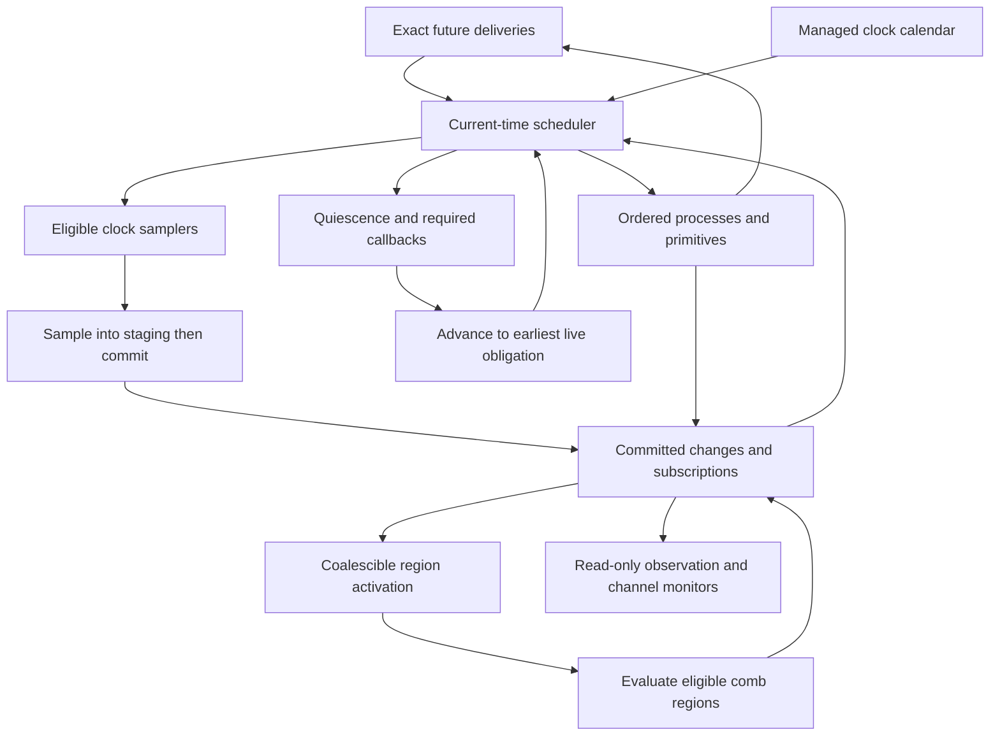

# 06 — Execution data model

Draft, October 25, 2026. This specification defines the proposed storage and dispatch model for clocked, clockless and hybrid simulation. It refines [execution semantics](01-execution-semantics.md) and the [compiler/runtime interface](02-compiler-runtime-interface.md); it does not change their scheduling rules or introduce another HDL IR. CIRCT remains the compiler foundation. The engine and the structures below are not implemented.

The central decision is **exact event delivery plus coalescible region activation**. Delays and suspended processes need ordered delivery; eligible combinational reevaluation needs inexpensive dirty bits. Both clocked and async execution use this distinction. Neither a global cycle nor a fixed time step is required.

## Immutable plan and backend layout

An immutable logical plan is shared by independent sessions. A backend variant supplies its own region partitioning, kernels and physical layout, with a checked mapping back to that logical plan. A CPU word offset is not a universal GPU address. The notation below describes responsibilities, not public Rust types or a frozen binary ABI.

| Table | Contents and invariants |
| --- | --- |
| Signals | Width, signedness, logical storage identity, driver ownership, visibility and subscriber range |
| Subscriptions | Compressed sparse row adjacency from a signal to change/posedge/negedge/level predicates and a region or process wait slot; dynamic waits additionally have session-owned registrations |
| Regions | `Comb`, `ClockSample`, `Process` or `Primitive`; inputs/outputs, kernel binding, effects, `Tracked`/`Always` activity policy and topological rank where valid |
| State elements | Register current/next bindings, latch/C-element/mutex state, primitive-private state, initialization bit, reset domain and owner; memory ports and delay models reference their separate descriptors |
| Clocks | Signal, eligible positive/negative-edge samplers, optional managed period/pause policy; generated RTL clocks retain their actual signal semantics |
| Drivers | Destination, captured-value policy, transport/inertial rule and cancellation owner |
| Memories | Geometry, ports, latency, masks, initialization and collision policy |
| Crossings | Source/destination regions, subscribed signals, actual sampling clock where relevant and proven minimum lookahead; scheduling/placement metadata only |
| Observation plan | Required signals, commit probes and effects; determines which transformations are eligible |
| Channel monitors | Protocol/version and req/ack/data/clock/reset bindings used only to observe the circuit |
| Identity overlay | Dense index to stable semantic identity and source; explicit one-to-many mappings under splitting/replication |
| Backend layout | Checked offsets, sizes, alignments, word widths, batch strides, kernel ABI and artifact hashes |

Topological rank applies within a proven acyclic pure region. It does not impose a global order on arbitrary feedback. Stateful async feedback uses qualified primitives/processes; SCC analysis alone cannot supply its semantics. Pure replication preserves one logical identity, and effects have one execution owner.

Keep compiler tables compact and indexed. Array-of-structures versus structure-of-arrays is a measured choice per table/backend; there is no requirement to force every metadata record into the GPU layout. Validate subscription completeness, effect ownership, storage bounds and identity mappings before execution.

## Per-session storage

```rust
// Illustrative internal ownership, not compilable declarations or a public ABI.
struct Session {
    now: TimePoint,                  // observed ticks, delta and current phase
    values: Words,                   // current circuit values and state
    memories: MemoryStorage,         // session-owned contents with checked bindings
    next: StagingBuffers,            // sampled state, write masks and batch ownership
    initialized: BitSet,
    active: RegionActivity,          // bits, summary words and reactivation generations
    continuations: ContinuationArena,
    waits: WaitRegistrations,
    driver_generations: Generations,
    clocks: ClockStates,             // running/paused, polarity, generation, next edge
    reset_epochs: Epochs,
    rng: KeyedCounters,
    future: FutureEventQueue,
    clock_calendar: ClockCalendar,
    ready: ReadyWork,                // ordered process/primitive deliveries as required
    inactive: InactiveWork,
    nba: OrderedStagedWrites,
    callbacks: CallbackQueues,
    payloads: CapturedPayloadArena,
    observations: ObservationState, // monitors and bounded append-only commit stream
}
```

Pending transitions live in delivery queues/calendar, with payload arena references where needed. Primitive state may retain a cancellation generation or pending-delivery handle, but must not contain a second independently authoritative copy of the transition. `next` is staging for a particular sample/commit batch, not a second entire model that becomes current once per global cycle. Behavioral NBA batches retain their specified ordering rather than being collapsed into an unordered next-value array.

Clock pause, wait replacement and inertial cancellation have distinct generation owners. Counters for generations, deltas, epochs, event order and random decisions are checked; wraparound must not revive stale work. A backend narrowing a counter must reject or stop before exhausting it. Cancellation tombstones and retired payloads are reclaimed only when no live delivery can reference them.

Handshake monitor state is derived from committed signals/probes. Circuit kernels cannot read it. Actual handshake storage in bridge RTL remains ordinary circuit state. Reset epochs and random counters follow semantic owners, including accepted persistent effects that survive an application reset. Observation streaming may apply backpressure or stop at an explicit frontier; it cannot change circuit choices or silently lose required records.

## Two dispatch mechanisms

| Mechanism | Purpose | May coalesce? |
| --- | --- | --- |
| Future deliveries | Positive-delay driver transactions, timed process wakeups and future external input | No, except cancellation/filtering explicitly permitted by the model |
| Clock calendar | Managed clock edge occurrences with exact times and generation checks | No; separate storage may avoid general queue operations |
| Current-time ordered work | Process resumes, required primitive transitions, inactive work, NBA writes and callbacks | Only under that operation's explicit semantics |
| Region activation | An eligible region must recompute from its inputs in the current evaluation round | Yes, when repeated requests require the same reevaluation |

Updating a register or zero-delay req/ack signal does not automatically allocate a future event. Its committed change evaluates subscriptions and sets eligible activation bits or registers required current-time work. Pure combinational supernodes can then execute in topological order, skipping inactive regions. Always-run regions still publish changes to tracked consumers. Consume activation before evaluation, or use generations, so evaluation cannot erase a new activation.

**Coalescing wake requests is not permission to erase signal transitions.** A same-tick pulse can trigger an edge-sensitive process, latch, C-element, assertion or required waveform/protocol observation. Preserve required transition/trigger information even if a later change overwrites the current value. Deliver sensitive reactions under the process/phase contract; do not force a suspended process to execute between another process's consecutive blocking statements. Merge pure reevaluations only across boundaries where the compiler proves that intermediate values are not semantically required. An observation mode may require a less aggressively fused plan. Full-scan mode retains trigger conditions and executes effects exactly once.

### Event time and identity

A logical future-delivery record contains:

```rust
struct FutureDelivery {
    ticks: i64,                     // exact nonnegative femtoseconds
    order: SemanticOrderKey,        // stable producer identity and local sequence
    target: RuntimeTarget,
    kind: DeliveryKind,             // also selects the proper current-time work class
    generation: CancellationToken,
    payload: CapturedPayloadRef,    // inline value or checked arena slice
}
```

Payloads are captured when scheduled; delivery cannot reread a changed source. Transport preserves scheduled transitions; inertial cancellation obeys the [primitive contract](03-async-model-contracts.md). Unordered conflicting writes remain errors even when a deterministic key can order their records.

Future records do not preassign a delta number. The coordinator assigns delta/phase as work is processed and phases re-enter. Delivery kind preserves a delayed NBA's intended work class; removing a future delta field does not remove assignment semantics. `TimePoint` belongs to the execution frontier and observations. Sorting `(time, delta, phase)` cannot replace the iterative scheduler in spec 01. Neither physical lane, allocation address nor worker arrival order contributes to semantic ordering; observation `seq` is a separate capture-stream identity.

An event with fields `i64 ticks, u64 seq, u32 dest, u8 kind, u32 generation, u64 payload` totals 33 bytes before padding and occupies 40 bytes with conventional 8-byte alignment. `repr(C)` preserves C layout rules, not a desired 32-byte size. A compact encoding would need explicit tags/limits or side tables and target layout tests. A GPU may use separate arrays for event fields. [Rust layout rules](https://doc.rust-lang.org/reference/type-layout.html#reprc-structs).

## Region execution and hybrid scheduling



The arrows describe work flow; spec 01's phase state machine controls ordering. Observations attach to their required commit points, not just final quiescence.

**Clocked execution.** One clock edge dispatches its eligible sampler kernels, rather than enqueuing one future event per register. For normalized registers triggered in the same sampling batch, sample `values` into staging before committing any of those writes. This includes coincident independent clock edges: exchanging registers must see the required pre-update state. An edge generated by a commit enters the appropriate later scheduling round and sees the state then visible. Behavioral processes preserve their own statement/NBA semantics. Committed outputs activate downstream subscribers in either clocked or async regions; settle all required current-time work before advancing.

**Async execution.** Signal changes activate pure regions and qualified primitives/processes. Only an actual timing obligation needs future-time storage. Latch transparency, C-element hold, mutex choices and delayed transitions retain their registered model semantics. Bounded delta and work budgets diagnose zero-time nonconvergence; an intentional positive-delay oscillator remains valid. A clockless session may have no clock-calendar entries at all.

**Crossings.** Execution uses ordinary subscriptions across region kinds. Buffering, synchronization, capture and acceptance behavior belong to the imported bridge RTL or its explicitly qualified binding. No scheduling adapter adds hidden storage or an extra acknowledgment. A clocked commit wakes async subscribers within the same timestamp under the normal phase rules; it does not unconditionally add a delta. An async change becomes visible to a clocked sampler at its actual eligible edge, with same-time ordering/reset rules preserved. A paused clock causes no synthetic capture.

Crossing descriptors may constrain partitioning, batching and lookahead. Assume zero lookahead unless a conservative lower bound is proved from the declared model; a profile or typical handshake latency is not proof. Do not infer extra synchronizer latency or analog behavior from a crossing descriptor.

The observation layer retains **one transaction identity per channel**, joined by `boundary.link` at the actual transfer point. Visibility, acceptance and persistent effect commit can occur at different times. They are not a single shared execution transaction. The [worked hybrid fixture](../examples/hybrid-flow/README.md) already demonstrates this separation; its public schema does not need to change.

### Fast clocked loop

Managed clocks may use a small separate calendar with a cached minimum, making the next-frontier comparison constant-time. Updating/selecting among many clocks still has a measured cost; use a scan for a few clocks or a suitable indexed structure for larger sets. `next_event` returns the earliest live obligation across this calendar and the general queue, not merely the next heap item.

Queue bypass is valid only when:

1. Current-time work has settled and the selected clock batch precedes every competing delivery, external interaction, observation/callback deadline and run limit. Ties go through the normal scheduler unless their complete ordering has been qualified.
2. All eligible samplers and downstream required effects/observations execute with normal sample/commit and phase semantics. Clock pause/reset generations remain effective.
3. New output changes, delay scheduling, clock generation/gating or crossing activity update the safe frontier before another edge executes. Outgoing work can invalidate the window even if no crossing input changed.
4. Budgets/cancellation stop at the same documented atomic boundaries, with resumable current-time state.

Run successive safe edge batches without inserting/removing managed edges in the general queue. This removes queue overhead; it does not skip logical edges, async reactions or observable work. Measure the gain separately from activity skipping. For a single CPU run, the primary GSIM-inspired hypothesis is eliminating inactive evaluations and unnecessary bookkeeping; parallelism is a separate optimization.

## CPU and GPU layouts

| Storage | CPU baseline | GPU batch candidate |
| --- | --- | --- |
| Values and staging | Per-session contiguous aligned words | `values[word][lane]` and matching staging, adjacent lanes contiguous; pad to selected device subgroup width |
| Activity | Per-session region bits and optional summary bitmap | Bitmasks across sessions such as `active[region][lane / W]`; qualified atomic/ballot ownership and reactivation rules |
| Topology and kernels | Immutable shared model | Immutable shared topology, compiled kernels or another qualified device execution form |
| Pending deliveries | Exact general heap plus managed clock calendar | Per-session bounded calendar/ring, heap or sorted-array experiment with exact timestamps and ordering |
| Session identity | Stable run/case identity | Explicit lane-to-session map; all state, queues, counters and observations follow the session during compaction |

`values[word][lane]` is **lane-contiguous (lane-minor)** storage. Optional Boolean bitslicing is a separate kernel choice, with explicit arithmetic and memory handling; it is not implied by packing activation bits. Device subgroup width and alignment are backend parameters, not a universal 32-lane ABI. Adjacent accesses are the motivation for this candidate layout; measure actual access efficiency. [CUDA memory coalescing guidance](https://docs.nvidia.com/cuda/cuda-c-best-practices-guide/index.html#coalesced-access-to-global-memory).

A bounded calendar ring is an experiment, not an assumed fastest queue. It must retain exact timestamps/order within buckets, handle far-future events and ring wrap, and distinguish capacity exhaustion from time overflow. Buckets are an index, not a rounding of simulated time. Compare rings, heaps and small sorted arrays on sparse, bursty and widely separated events. Report enqueue/extract cost, memory, occupancy and spill frequency.

Queue/payload/observation capacity is reserved before committing a work item that creates deliveries. Exhaustion yields at a recoverable frontier with all pending work intact, or fails explicitly. Host-assisted capacity growth/spill, if implemented, resumes the same device session through a tested protocol; it is not silent migration to CPU execution. A device fault still fails the affected run. Never drop an event or replay an already committed effect after overflow.

Clocked batches with shared edge schedules are the strongest initial GPU candidate, but data-dependent logic, memory accesses and differing activity can still diverge. Async delay sweeps have independent logical times and event sequences. Regrouping by next-event time and compatible ready kernel may help, but must justify compaction cost and preserve each session's order, random keys and complete state. Equal times alone do not imply equal work. No independent run must advance merely to stay aligned with another lane.

For the small RISCay-MCU, prioritize aggregate runs over seeds/delays. Single-design GPU acceleration is an unproven later experiment; establish the crossover against CPU batches before claiming a benefit. Keep resident state and amortize launches/transfers where safe. CPU-only execution remains a complete MVP path.

## Performance claims and qualification

The model permits activity-based clocked acceleration and GPU batch throughput; it establishes no speedup by itself. The **20× Verilator ambition** and the earlier **0.80× GSIM release gate** are distinct. Report single-run clocked speed, hybrid/async speed against a qualified timing baseline, and batch throughput separately under the [performance protocol](../test-plan.md#controlled-performance-experiments). Do not pool them into one ratio.

These are planned implementation fixtures, not tests already satisfied by documentation checks:

| Fixture | Expected evidence | Existing suite |
| --- | --- | --- |
| Dense IDs, invalid ranges and replicated logical identity | Loader rejects bad mappings; effects and observations remain exactly once | SEM-06, OPT-02 |
| Duplicate pure activation versus same-tick req/ack pulse | Redundant reevaluation coalesces; sensitive state, triggers and required observations preserve each relevant transition | OPT-01, SEM-03, ASY-02 |
| Coincident clocks, generated edges and mixed active/NBA work | Independent expected traces distinguish pre-update sampling from later generated-edge sampling | SEM-02/03 |
| Transport/inertial, replaced waits and generation exhaustion | Captured payload preserved; only legally canceled work disappears; no wraparound resurrection | ASY-03, DUR-02 |
| Queue-bypassed edges versus conservative scheduling | Exact required traces across event ties, outgoing delayed effects, callbacks, pause/reset, run limits and resume; assert bypass actually ran | SEM-02/03, OPT-02 |
| Four-phase/Click bridges with paused/gated consumers | Actual RTL storage/capture and per-channel lineage; no synthetic clock, buffer or acknowledgement | ASY-02, FLOW-03 |
| Monitor disabled/enabled and different batching | Same circuit values, effects and random decisions; scoped observation completeness | OPT-02, ASY-04 |
| Device partial lanes, regrouping, ring wrap and overflow | Actual device/reference agreement; retained events and exactly-once effects across spill or explicit failure | Optional backend qualification |

Use the independent tiny evaluator and hand-authored traces before optimized-versus-conservative comparisons. Inject negative controls such as dropped same-tick pulses, premature register commit, stale generation delivery, queue overflow loss and RNG keyed by lane; require their intended checker to fail. Allocation/ABI assertions become required on each supported native/device target when concrete record layouts are implemented.

Implement in order: checked logical plan and CPU storage; independent scheduling fixtures; serial activations and ordered effects; guarded clock-calendar bypass; profiling/held-out activity policies; optional GPU queue/layout probes. This keeps clockless and hybrid semantics in the foundation while making optimization independently reviewable.
